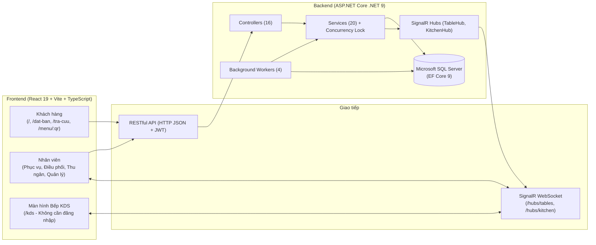
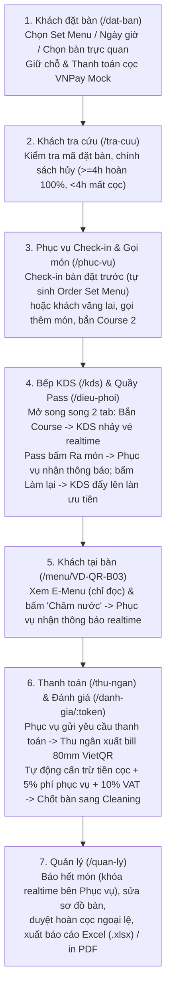

# Tài Liệu Nắm Bắt Cấu Trúc Dự Án VinDining (Phục Vụ Thuyết Trình & Demo)

Tài liệu tổng hợp kiến trúc, cấu trúc mã nguồn Backend/Frontend, luồng nghiệp vụ khép kín và bộ dữ liệu chạy thử để phục vụ thuyết trình và demo hệ thống quản lý nhà hàng Fine Dining **VinDining**.

---

## 1. Tổng Quan & Kiến Trúc Hệ Thống

VinDining là hệ thống quản lý vận hành nhà hàng Fine Dining khép kín theo mô hình **MVC kết hợp RESTful API** và **đồng bộ thời gian thực (SignalR)**:

- **Frontend (View — Presentation Layer)**: React SPA giao tiếp với Backend qua RESTful API (JSON + JWT Bearer) và WebSocket SignalR. Hỗ trợ 2 chế độ chạy: **Mock Mode** (in-browser mock API + mock realtime để demo độc lập) và **Live Mode** (kết nối trực tiếp ASP.NET Core Backend).
- **Backend (Model & Controller)**: ASP.NET Core (.NET 9) Web API chia lớp rõ ràng: `Controllers` (điều hướng HTTP, RBAC, validate DTO) → `Services` (toàn bộ nghiệp vụ, khóa tranh chấp bàn, tính thuế/cấn trừ cọc) → `Data / EF Core 9` (SQL Server).
- **Realtime Engine**: 2 SignalR Hub tách biệt theo ngữ cảnh (`TableHub` cho sơ đồ bàn/thu ngân/yêu cầu phục vụ và `KitchenHub` cho KDS bếp/quầy Pass).
- **Background Workers**: 4 dịch vụ chạy nền tự động nhả bàn giữ chỗ hết hạn, giám sát SLA bếp, nhắc lịch đặt bàn và gửi khảo sát sau bữa ăn.



---

## 2. Công Nghệ Sử Dụng (Tech Stack)

| Thành phần | Công nghệ chính |
| :--- | :--- |
| **Backend** | ASP.NET Core Web API (.NET 9), C#, Entity Framework Core 9, ASP.NET Core Identity, JWT Bearer, SignalR, Swashbuckle (Swagger/OpenAPI), DotNetEnv |
| **Cơ sở dữ liệu** | Microsoft SQL Server (Code-First Migrations + Fluent API Configurations) |
| **Frontend** | React 19, TypeScript, Vite 8, Tailwind CSS v4, React Router v7, TanStack Query v5, Zustand v5, Axios, `@microsoft/signalr`, Lucide Icons, `qrcode`, `write-excel-file` |
| **Kiểm thử (Testing)** | Backend: xUnit (`backend/tests/UnitTests`). Frontend: Vitest + Testing Library (55 tests), Oxlint, Playwright E2E + Axe Accessibility (30 tests) |

---

## 3. Cấu Trúc Thư Mục Tổng Thể

```text
VinDining/
├── backend/                     # ASP.NET Core (.NET 9) Web API & Unit/Integration Tests
│   ├── Restaurant.sln
│   ├── src/API/                 # Project API chính (Controllers, Services, Models, Data, Hubs, Workers)
│   └── tests/UnitTests/         # 8 file test xUnit (Auth, CRUD, Reservation/Payment, Order/Billing, ClosedLoop)
├── frontend/                    # React SPA (Vite + TypeScript + Tailwind)
│   ├── e2e/                     # 6 bộ kịch bản Playwright E2E (Guest, Waitstaff, Pass/KDS, Cashier, Manager, A11y/Responsive)
│   ├── public/                  # Tài nguyên tĩnh (ảnh dark/light, icons)
│   ├── src/                     # Mã nguồn ứng dụng React
│   ├── .env / .env.development  # Cấu hình URL API, SignalR và cờ VITE_USE_MOCK
│   └── package.json
├── docs/                        # Toàn bộ tài liệu phân tích, kiến trúc, ADR, sơ đồ, báo cáo
│   ├── adr/                     # Architecture Decision Records (ADR 0001–0005)
│   ├── Diagram/                 # Sơ đồ Draw.io, PlantUML (ERD, Class, Sequence, Use Case)
│   ├── prototype/               # Quy tắc prototype (PROTOTYPE_RULES.md), danh sách màn hình
│   ├── api.md / controllers.md  # Đặc tả API và Controller
│   └── FRONTEND_ARCHITECTURE.md # Thiết kế kiến trúc Frontend
├── CONTEXT.md                   # Ngữ cảnh domain và ngôn ngữ thống nhất
└── BAO_CAO_PHAN_TICH_HE_THONG.docx
```

---

## 4. Chi Tiết Cấu Trúc Backend (`backend/src/API/`)

### 4.1. Thư mục & vai trò từng lớp

```text
backend/src/API/
├── Program.cs                   # Cấu hình DI, SQL Server, Identity, JWT, CORS, Swagger, SignalR Hubs, JSON Enum Converter
├── Controllers/                 # 16 RESTful API Controllers
├── Services/                    # 20 Business Services + thư mục Interfaces/
├── Models/
│   ├── Entities/                # 13 thực thể CSDL (EF Core)
│   ├── Enums/                   # 9 Enum trạng thái & phân loại
│   ├── Identity/                # ApplicationUser, ApplicationRole
│   └── Common/                  # BaseEntity, Result<T>, DomainExceptions, ValidationException
├── DTOs/                        # Request/Response DTOs trao đổi giữa BE và FE
├── Data/
│   ├── ApplicationDbContext.cs  # EF Core DbContext
│   ├── Configurations/          # 14 file Fluent API EntityTypeConfiguration
│   └── Migrations/              # 7 bản migration lịch sử tiến hóa schema
├── Hubs/                        # TableHub.cs, KitchenHub.cs
├── Workers/                     # 4 Background Services (IHostedService)
└── Middlewares/                 # GlobalExceptionMiddleware.cs (chuẩn hóa JSON lỗi & HTTP status)
```

### 4.2. Các nhóm Controller (`Controllers/`)

| Nhóm nghiệp vụ | Controller | Chức năng chính |
| :--- | :--- | :--- |
| **Xác thực & Hệ thống** | `AuthController`, `HealthController`, `TestingController` | Đăng nhập JWT, khóa tài khoản khi sai mật khẩu, kiểm tra trạng thái hệ thống |
| **Khách đặt bàn & Thực đơn** | `ReservationController`, `MenuController`, `TableController` | Kiểm tra bàn trống theo khung giờ, giữ chỗ tạm thời, đặt cọc (VNPay/Mock), hủy & hoàn cọc, xem thực đơn/Set Menu, check-in |
| **Phục vụ, Bếp & Thanh toán** | `OrderController`, `InvoiceController`, `ServiceCallController`, `FeedbackController` | Tạo/cập nhật order, bắn món theo Course (Course Firing), đổi bàn, xác nhận ra món/làm lại tại quầy Pass, tạm tính & thanh toán cấn trừ cọc, gọi nhân viên từ QR bàn, gửi đánh giá |
| **Quản trị (Manager/Admin)** | `AdminMenuController`, `AdminTableController`, `AdminRefundController`, `AdminStaffController`, `ReportController` | Quản lý thực đơn & Set Menu, kéo-thả sơ đồ bàn & tạo QR, duyệt/từ chối hoàn cọc ngoại lệ, quản lý tài khoản nhân viên, báo cáo doanh thu |

### 4.3. Thực thể dữ liệu chính (`Models/Entities/`)

Hệ thống gồm **13 bảng nghiệp vụ** (ngoài bảng Identity):

- **Đặt bàn & Khách**: `Guest`, `Reservation`, `Deposit`, `Table` (có tọa độ `PosX`, `PosY` cho sơ đồ bàn và mã QR tĩnh).
- **Thực đơn**: `Category`, `MenuItem`, `TastingMenu` (Set Menu), `TastingMenuItem`.
- **Phục vụ & Bếp**: `Order`, `OrderItem` (lưu `CourseType`, trạng thái `Hold`/`Preparing`/`Ready`/`Served`, thời điểm bắn món `FiredAt`, cờ ưu tiên `IsPriority`).
- **Thanh toán & Hậu mãi**: `Invoice` (cấn trừ `Deposit`, phí phục vụ 5%, VAT 10%), `Feedback`, `Staff`.

### 4.4. Dịch vụ đặc thù cần nhấn mạnh khi thuyết trình

- **Chống đặt trùng bàn (`TableConcurrencyLock`)**: Cơ chế khóa theo bàn/khung giờ ngăn 2 khách giữ cùng một bàn tại cùng thời điểm.
- **Tích hợp thanh toán cọc (`IPaymentGateway`)**: Tách interface cho phép chuyển đổi giữa `VnPayPaymentGateway` và `MockPaymentGateway`.
- **Realtime SignalR (`TableHub`, `KitchenHub`)**:
  - `/hubs/tables`: Cập nhật trạng thái bàn, yêu cầu thanh toán (`checkout:requested`), hóa đơn đã tất toán, yêu cầu phục vụ từ QR, cập nhật trạng thái hết món.
  - `/hubs/kitchen`: Cập nhật order mới, bắn Course mới (`course:activated`), yêu cầu làm lại (`item:remake-requested`), cảnh báo quá hạn SLA (`sla:alert`), xác nhận ra món (`item:served`).
- **4 Background Workers (`Workers/`)**:
  - `ReleaseExpiredLocksWorker`: Tự động nhả bàn giữ chỗ quá hạn chưa thanh toán cọc.
  - `OrderSlaMonitorWorker`: Quét thời gian chế biến món để cảnh báo sắp trễ (80%) và quá hạn (>100%) trên KDS/Pass.
  - `ReservationReminderWorker`: Gửi nhắc lịch trước giờ ăn.
  - `DiningSurveyWorker`: Tự động phát sinh/gửi khảo sát trải nghiệm sau khi thanh toán.

---

## 5. Chi Tiết Cấu Trúc Frontend (`frontend/src/`)

### 5.1. Kiến trúc thư mục

```text
frontend/src/
├── App.tsx                      # Khai báo toàn bộ Router, Lazy Loading từng trang và ProtectedRoute theo vai trò
├── layouts/                     # 5 Layout chuyên biệt theo thiết bị sử dụng
│   ├── GuestLayout.tsx          # Website Khách (Desktop/Mobile)
│   ├── StaffMobileLayout.tsx    # App Phục vụ cầm tay (Mobile POS)
│   ├── StaffTabletLayout.tsx    # Màn hình Quầy Pass (Tablet ngang)
│   ├── StaffDesktopLayout.tsx   # POS Thu ngân & Backoffice Quản lý (Desktop)
│   └── WallLayout.tsx           # Màn hình Bếp KDS treo tường (Full screen, không điều hướng)
├── pages/
│   ├── guest/                   # Trang chủ, Đặt bàn (gộp sơ đồ bàn), VNPay Mock, Tra cứu/Hủy, QR E-Menu, Đánh giá
│   ├── kds/                     # Màn hình Bếp KDS (phân trang tự động, làn Làm lại)
│   ├── staff/
│   │   ├── waitstaff/           # Sơ đồ bàn, Check-in, Tạo/Xem Order, Bắn Course, Gọi thêm, Đổi bàn, Thông báo
│   │   ├── expediter/           # Quầy Pass: theo dõi SLA, Xác nhận ra món, Yêu cầu làm lại
│   │   ├── cashier/             # Hàng đợi thanh toán, Check-in tại quầy, Tạm tính & in bill 80mm VietQR, Hóa đơn hôm nay
│   │   └── manager/             # Thực đơn/Set Menu, Sơ đồ bàn (kéo-thả/phím mũi tên), Duyệt hoàn cọc, Nhân sự, Báo cáo Excel/PDF
│   └── LoginPage.tsx            # Đăng nhập nhân viên (có cơ chế khóa khi nhập sai)
├── domain/                      # Pure business rules phía FE (tính cọc, chính sách hủy >= 4h / < 4h, tính hóa đơn, SLA, lọc bàn trống)
├── services/
│   ├── api/client.ts            # Axios client: tự gắn JWT, bóc vỏ ApiResponseEnvelope, chuyển đổi Mock/Live
│   ├── mock/                    # Bộ giả lập đầy đủ (db.ts, seed.ts, router.ts, 9 file handlers/, backgroundJobs.ts)
│   └── realtime/                # Adapter chuyển đổi giữa mockRealtimeClient và signalrRealtimeClient
├── stores/                      # Zustand stores (useAuthStore, useThemeStore, useToastStore, useWaitstaffNotificationsStore)
├── components/                  # UI components tái sử dụng (ui/, auth/ProtectedRoute, ReceiptSlip80mm)
└── types/                       # TypeScript DTO contracts đồng bộ với Backend
```

### 5.2. Cơ chế chuyển đổi Mock Mode ↔ Live Backend Mode

- Biến môi trường `VITE_USE_MOCK` (mặc định `VITE_USE_MOCK=true` trong `frontend/.env.development`):
  - `VITE_USE_MOCK=true` (**mặc định khi chạy `npm run dev` / demo độc lập**): `apiClient` gắn `installMockAdapter` và `realtimeClient` dùng `createMockRealtimeClient()` (đồng bộ realtime giữa các tab trình duyệt cùng origin qua `BroadcastChannel`/`localStorage`).
  - `VITE_USE_MOCK=false` (**chạy với Backend thật — opt-in**): tạo file untracked `frontend/.env.development.local` (đã được gitignore qua `*.local`) với nội dung `VITE_USE_MOCK=false`. Khi đó `apiClient` gọi trực tiếp `VITE_API_URL` (`http://localhost:5159/api`) và `realtimeClient` kết nối SignalR tới `VITE_SIGNALR_URL` (`http://localhost:5159/hubs`).

### 5.3. Bản đồ Tuyến đường (Routes) theo Vai trò

| Vai trò | Thiết bị mục tiêu | Các tuyến đường chính | Quyền truy cập |
| :--- | :--- | :--- | :--- |
| **Khách hàng (Guest)** | Mobile / Desktop | `/`, `/dat-ban`, `/thanh-toan/vnpay/:code`, `/tra-cuu`, `/menu/:qrCode`, `/danh-gia/:token` | Công khai (không cần đăng nhập). QR E-Menu chỉ xem thực đơn + gọi nhân viên (không tự đặt món) |
| **Bếp (KDS)** | Màn hình treo tường | `/kds` (hỗ trợ `?demo=full` để demo phân trang & SLA) | Không cần đăng nhập, chỉ hiển thị (không có nút thao tác dữ liệu) |
| **Phục vụ (Waitstaff)** | Điện thoại (Mobile POS) | `/phuc-vu`, `/phuc-vu/check-in`, `/phuc-vu/ban/:id`, `/phuc-vu/tao-order/:id`, `/phuc-vu/order/:id`, `/phuc-vu/goi-them/:id`, `/phuc-vu/doi-ban/:id`, `/phuc-vu/thong-bao` | `Waitstaff`, `Manager` |
| **Điều phối (Expediter)** | Tablet tại Quầy Pass | `/dieu-phoi` | `Expediter`, `Manager` |
| **Thu ngân (Cashier)** | Máy tính quầy thu ngân | `/thu-ngan`, `/thu-ngan/check-in`, `/thu-ngan/tam-tinh/:id`, `/thu-ngan/hoa-don` | `Cashier`, `Manager` |
| **Quản lý (Manager)** | Desktop Backoffice | `/quan-ly` (Thực đơn), `/quan-ly/so-do-ban`, `/quan-ly/hoan-coc`, `/quan-ly/tai-khoan`, `/quan-ly/bao-cao` | `Manager` |

---

## 6. Luồng Nghiệp Vụ Khép Kín Để Demo (End-to-End Flow)

Đây là kịch bản trình diễn mượt nhất để ban giám khảo thấy rõ toàn bộ sức mạnh đồng bộ của hệ thống:



---

## 7. Sổ Tay Chạy Demo Nhanh (Cheat Sheet)

### 7.1. Tài khoản nhân viên Demo (đăng nhập tại `/dang-nhap`)

Tất cả tài khoản demo dùng chung mật khẩu: **`VinDining@2026`**

| Vai trò | Tên đăng nhập | Họ và tên | Màn hình sau đăng nhập |
| :--- | :--- | :--- | :--- |
| **Phục vụ (Waitstaff)** | `mai.tt` | Trần Thị Mai | `/phuc-vu` |
| **Điều phối (Expediter)** | `quan.lm` | Lê Minh Quân | `/dieu-phoi` |
| **Thu ngân (Cashier)** | `ha.pt` | Phạm Thu Hà | `/thu-ngan` |
| **Quản lý (Manager)** | `long.dh` | Đỗ Hoàng Long | `/quan-ly` |

### 7.2. Dữ liệu có sẵn trong Mock Seed (dùng ngay khi demo)

- **Mã đặt bàn tra cứu (`/tra-cuu`)** — SĐT chung: `0901 234 567` (Nguyễn Văn An):
  - `VD-7K3Q` (Bàn `B05`, 4 khách, có đặt trước *Set Menu Thượng Hạng*, trạng thái `Reserved`, khung giờ `< 4h` để demo cảnh báo mất cọc khi hủy hoặc demo check-in).
  - `VD-4M2P` (Bàn `B04`, 2 khách, trạng thái `Reserved`).
  - `VD-9H1L` (Bàn `B07`, 6 khách, trạng thái `PendingDeposit`).
- **QR E-Menu tại bàn**: `/menu/VD-QR-B03` (bàn đang phục vụ, có thể gửi yêu cầu *Châm nước* sang tab Phục vụ).
- **Khảo sát sau bữa ăn**: `/danh-gia/survey-demo-b01` hoặc `/danh-gia/survey-demo-v02`.
- **KDS đầy tải (demo phân trang & cảnh báo SLA)**: `/kds?demo=full`.

### 7.3. Lệnh chạy nhanh

- **Chạy Frontend (Mock Mode — mặc định)**:
  ```powershell
  cd frontend
  npm run dev
  # Mở http://localhost:5173/
  ```
- **Chuyển sang chạy Frontend + Backend thật (opt-in):**
  1. Tạo file untracked `frontend/.env.development.local` (`*.local` đã được gitignore) với nội dung `VITE_USE_MOCK=false`.
  2. Chạy Backend: `cd backend/src/API; dotnet run` (cổng `http://localhost:5159`, Swagger tại `/swagger`).
  3. Chạy Frontend: `cd frontend; npm run dev`.
- **Kiểm chứng chất lượng trước khi thuyết trình**:
  ```powershell
  cd frontend
  npm run lint     # Kiểm tra oxlint
  npm test         # 55 unit & mock integration tests
  npm run build    # Kiểm tra TypeScript & build production
  npm run e2e      # 30 kịch bản Playwright E2E + Accessibility + Responsive
  ```
