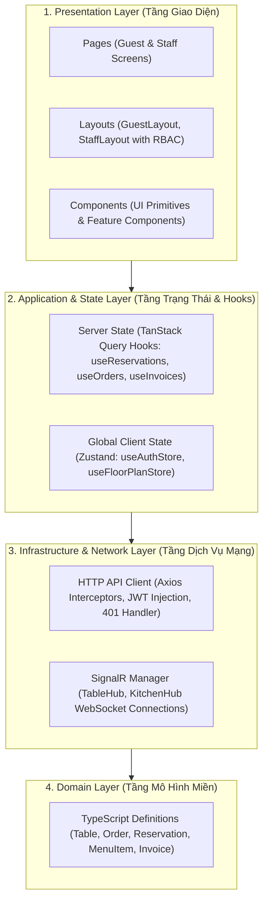
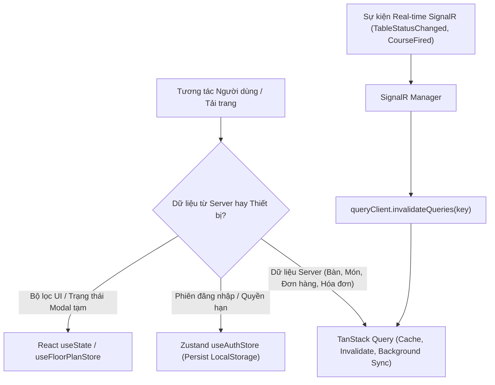
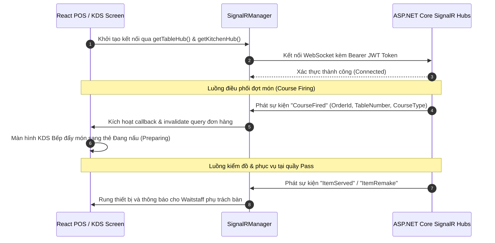

# VinDining — Tài Liệu Đặc Tả Kiến Trúc Frontend

Tài liệu đặc tả kiến trúc tổng thể, mô hình phân tầng, luồng dữ liệu và quy chuẩn tổ chức mã nguồn của phân hệ giao diện người dùng (Frontend SPA) trong hệ thống VinDining.

---

## 1. Tổng quan Kiến trúc

Phân hệ Frontend được xây dựng dưới dạng Single Page Application (SPA) hiệu năng cao, phục vụ đồng thời hai nhóm người dùng chính:
* **Khách hàng (Guest Subsystem - BYOD / Tablet)**: Trải nghiệm đặt bàn trực tuyến, tra cứu thực đơn E-Menu mỹ thực, thanh toán cọc qua VNPAY và gửi đánh giá dịch vụ.
* **Nhân sự nội bộ (Staff Subsystem - Mobile POS / Pass / Management)**: Theo dõi sơ đồ bàn thời gian thực, ghi nhận Order tại bàn, kích hoạt Course Firing, kiểm soát chất lượng ra món tại quầy Pass (Expediter), và quyết toán hóa đơn cấn trừ tiền cọc.

Kiến trúc tuân thủ mô hình phân tầng phân tách rõ ràng trách nhiệm giữa Tầng hiển thị (Presentation), Tầng trạng thái (State & Hooks), Tầng mạng & dịch vụ (Network & API Services), và Tầng mô hình miền (Domain Types).



---

## 2. Công nghệ & Thư viện Chủ đạo

| Phân hệ / Thư viện | Phiên bản | Vai trò kỹ thuật trong hệ thống |
| :--- | :--- | :--- |
| **React** | 19.x | Thư viện UI cốt lõi kết hợp TypeScript phục vụ render component với tính an toàn kiểu dữ liệu cao. |
| **Vite** | 8.x | Công cụ build và bundling siêu tốc, hỗ trợ Hot Module Replacement (HMR) trong môi trường phát triển. |
| **Tailwind CSS** | v4.x | Thiết kế giao diện theo phong cách Fine Dining sang trọng (Dark Gold Luxury Theme), tối ưu hóa dung lượng CSS xuất xưởng. |
| **TanStack Query** | v5.x | Quản trị toàn bộ Server State: bộ nhớ đệm (caching), tự động đồng bộ (refetching), khử trùng lặp truy vấn (deduplication) và quản lý trạng thái tải (loading/error). |
| **Zustand** | v5.x | Quản trị Global Client State gọn nhẹ, không boilerplate, phục vụ phiên đăng nhập nhân viên (`useAuthStore`) và bộ lọc sơ đồ bàn (`useFloorPlanStore`). |
| **@microsoft/signalr** | v10.x | Kết nối WebSocket thời gian thực đến `TableHub` (cập nhật trạng thái bàn) và `KitchenHub` (lệnh nấu theo Course, thông báo Pass/Remake). |
| **React Router** | v7.x | Định tuyến client-side, kiểm soát truy cập phân quyền vai trò (Role-based Protected Routes). |
| **Axios** | v1.x | HTTP client xử lý tự động gắn Bearer Token và điều hướng thu hồi phiên khi nhận lỗi 401 Unauthorized. |

---

## 3. Mô hình Phân tầng 4 Lớp (4-Layer Architecture)

### 3.1 Tầng Mô hình Miền (Domain Layer - `src/types/`)
Chứa toàn bộ các định nghĩa kiểu dữ liệu TypeScript độc lập hoàn toàn với framework và thư viện bên thứ ba:
* Phản chiếu chính xác các thực thể và DTO từ Backend: `Table`, `Reservation`, `Order`, `OrderItem`, `MenuItem`, `Invoice`.
* Định nghĩa các Enum dạng union string nghiêm ngặt: `TableStatus`, `ReservationStatus`, `OrderItemStatus`, `CourseType`, `PaymentMethod`.

### 3.2 Tầng Dịch vụ Mạng (Infrastructure / Network Layer - `src/services/`)
Đóng gói toàn bộ logic giao tiếp mạng với máy chủ Web API và SignalR Hub:
* `services/api/client.ts`: Khởi tạo instance Axios tập trung, tự động chèn token JWT vào header `Authorization`, xử lý timeout và interceptor đăng xuất khi hết hạn phiên.
* `services/api/*Api.ts`: Các module gọi API phân theo miền nghiệp vụ (`reservationApi`, `orderApi`, `invoiceApi`, `testingApi`).
* `services/signalr/signalrClient.ts`: Quản lý vòng đời kết nối WebSocket (kết nối, tự động kết nối lại khi mất mạng, ngắt kết nối).

### 3.3 Tầng Ứng dụng & Quản lý Trạng thái (Application & State Layer - `src/hooks/` & `src/stores/`)
Tách rời logic nghiệp vụ và dữ liệu khỏi giao diện:
* **Server State (`src/hooks/`)**: Sử dụng TanStack Query đóng gói các thao tác CRUD thành các custom hooks chuyên biệt (`useAvailableTables`, `useCreateReservation`, `useFireCourse`, `useSettleInvoice`). Khi một Mutation thành công, hook tự động gọi `queryClient.invalidateQueries` để cập nhật dữ liệu mới nhất mà không cần tải lại trang.
* **Client State (`src/stores/`)**: Sử dụng Zustand lưu trữ trạng thái phiên làm việc cục bộ của thiết bị:
  * `useAuthStore`: Lưu trữ thông tin tài khoản nhân viên đang đăng nhập, JWT Token và quyền hạn (Role).
  * `useFloorPlanStore`: Lưu trữ bộ lọc phân khu bàn ăn (Sảnh chính, VIP, Ban công) và trạng thái hiển thị bàn.

### 3.4 Tầng Giao diện (Presentation Layer - `src/pages/`, `src/layouts/`, `src/components/`)
Chỉ đảm nhận nhiệm vụ hiển thị và tiếp nhận tương tác người dùng:
* `components/ui/`: Thư viện thành phần giao diện nguyên tử có thể tái sử dụng (`Button`, `Badge`, `Card`, `Input`, `Modal`).
* `components/auth/`: Thành phần kiểm soát quyền truy cập trang (`ProtectedRoute`).
* `layouts/`: Khung mẫu bố cục trang (`GuestLayout` cho thực khách, `StaffLayout` cho nhân sự kèm thanh điều hướng và thông báo).
* `pages/`: Các màn hình hoàn chỉnh theo từng use case (`ReservationPage`, `EMenuPage`, `FloorPlanPage`, `ExpediterPage`, `ManagerPage`).

---

## 4. Chiến lược Quản lý Trạng thái & Dữ liệu



* Dữ liệu danh mục và giao dịch từ máy chủ được quản lý độc quyền bởi TanStack Query với thời gian lưu đệm (`staleTime`) là 60 giây, giúp hạn chế các yêu cầu mạng dư thừa.
* Khi có sự kiện thời gian thực từ SignalR phát về (ví dụ nhân viên kích hoạt Course Firing hoặc thu ngân đóng bàn), client gọi `invalidateQueries` tương ứng để kéo dữ liệu mới nhất về giao diện tức thì.
* Trạng thái xác thực nhân viên được lưu bền vững qua LocalStorage để duy trì phiên làm việc trên Mobile POS khi nhân viên di chuyển giữa các khu vực sóng Wi-Fi.

---

## 5. Cơ chế Đồng bộ Thời gian thực (SignalR Protocol)

Hệ thống thiết lập 2 kênh WebSocket SignalR riêng biệt để tránh nghẽn lưu lượng:



* Kênh `TableHub` (`/hubs/tables`): Truyền phát sự kiện thay đổi trạng thái bàn ăn (`Available` $\leftrightarrow$ `LockedForPayment` $\leftrightarrow$ `Reserved` $\leftrightarrow$ `Occupied` $\leftrightarrow$ `Cleaning`).
* Kênh `KitchenHub` (`/hubs/kitchen`): Truyền phát lệnh tạo đơn mới (`ReceiveNewOrder`), lệnh nấu đợt tiếp theo (`CourseFired`), lệnh làm lại món khẩn cấp (`ItemRemake`) và lệnh ra món (`ItemServed`).

---

## 6. Phân quyền Định tuyến & Bảo mật (RBAC Routing)

Hệ thống phân chia ranh giới bảo mật bằng component `ProtectedRoute`:

* **Khu vực công khai (Public Guest Area)**:
  * `/`: Trang chủ thương hiệu ẩm thực.
  * `/reserve`: Trang đặt bàn trực tuyến và thanh toán cọc giữ chỗ.
  * `/menu`: Trang hiển thị E-Menu ẩm thực chi tiết.
* **Khu vực xác thực nội bộ**:
  * `/login`: Cổng đăng nhập cho nhân viên nhà hàng.
* **Khu vực quản trị tác nghiệp (Protected Staff Area)**:
  * `/pos/tables`: Sơ đồ bàn ăn thời gian thực (Dành cho mọi nhân viên: `Waitstaff`, `Expediter`, `Manager`, `Admin`).
  * `/expediter`: Màn hình điều phối và kiểm soát chất lượng tại quầy Pass (Dành cho: `Expediter`, `Manager`, `Admin`).
  * `/manager`: Trung tâm cấu hình thực đơn, sơ đồ mặt bằng và báo cáo doanh thu (Dành riêng cho: `Manager`, `Admin`).

---

## 7. Cấu trúc Thư mục Chuẩn của Mã Nguồn

```
frontend/src/
├── assets/                     # Tài nguyên hình ảnh, biểu trưng thương hiệu
├── components/                 # Các thành phần giao diện dùng chung
│   ├── auth/                   # Kiểm soát định tuyến & phân quyền (ProtectedRoute)
│   └── ui/                     # Thư viện UI nguyên tử (Button, Badge, Card, Input, Modal)
├── hooks/                      # Custom hooks đóng gói TanStack Query
│   ├── useReservations.ts      # Hooks tra cứu bàn trống, tạo đặt bàn, hủy cọc
│   ├── useOrders.ts            # Hooks tạo đơn, Course Firing, Pass QC, Remake, Cancel
│   └── useInvoices.ts          # Hooks tính tạm tính, quyết toán cấn trừ cọc
├── layouts/                    # Khung mẫu giao diện (GuestLayout, StaffLayout)
├── lib/                        # Tiện ích bổ trợ (Tailwind clsx / cn merge)
├── pages/                      # Màn hình giao diện chức năng
│   ├── guest/                  # Giao diện khách hàng (ReservationPage, EMenuPage)
│   └── staff/                  # Giao diện nhân viên (FloorPlanPage, ExpediterPage, ManagerPage)
├── services/                   # Tầng giao tiếp hạ tầng & dịch vụ mạng
│   ├── api/                    # HTTP REST Client phân chia theo miền nghiệp vụ
│   └── signalr/                # Quản lý WebSocket Client (TableHub, KitchenHub)
├── stores/                     # Tầng quản lý trạng thái máy trạm (Zustand Stores)
└── types/                      # Toàn bộ định nghĩa kiểu dữ liệu TypeScript (Domain Models)
```
