# SƠ ĐỒ LỚP HỆ THỐNG (SYSTEM CLASS DIAGRAM)
## Dự án: Hệ thống Quản lý và Đặt bàn Nhà hàng Fine Dining (VinDining)

---

### 1. Tổng quan Kiến trúc Phân tầng
Sơ đồ lớp hệ thống (System Class Diagram) được tổ chức theo mô hình kiến trúc phân tầng Clean Architecture, thể hiện rõ ràng chuỗi liên kết:
* **Tầng Giao tiếp (Controllers & Real-time Hubs)**: Đóng vai trò tiếp nhận yêu cầu từ ứng dụng khách (Web/Tablet) hoặc duy trì kênh kết nối WebSocket thời gian thực (SignalR).
* **Tầng Xử lý Nghiệp vụ (Services)**: Trừu tượng hóa các quy tắc nghiệp vụ cốt lõi, tiếp nhận chỉ thị từ Controller và thực thi thao tác dữ liệu.
* **Tầng Thực thể Miền (Domain Models / Entities)**: Chứa các trường dữ liệu và thuộc tính nghiệp vụ, kế thừa từ lớp kiểm toán cơ sở `BaseEntity`.
* **Tầng Kiểu Liệt Kê (Enums)**: Chuẩn hóa các tập trạng thái hữu hạn xuyên suốt toàn bộ vòng đời thực đơn, bàn ăn, đơn hàng và giao dịch cọc.

---

### 2. Sơ đồ Class Diagram (Mermaid)

```mermaid
classDiagram
    %% ==========================================
    %% 1. TẦNG KIỂU LIỆT KÊ (ENUMS)
    %% ==========================================
    class StaffRole {
        <<Enumeration>>
        Waitstaff
        Expediter
        Manager
        Admin
    }

    class TableStatus {
        <<Enumeration>>
        Available
        LockedForPayment
        Reserved
        Occupied
        Cleaning
    }

    class TableZone {
        <<Enumeration>>
        MainHall
        VIP
        Balcony
    }

    class ReservationStatus {
        <<Enumeration>>
        AwaitingPayment
        Confirmed
        Completed
        Cancelled
        Expired
        Expired_AutoRefunded
    }

    class DepositStatus {
        <<Enumeration>>
        Pending
        Paid
        Refunded
        Forfeited
    }

    class OrderStatus {
        <<Enumeration>>
        Processing
        Completed
        Cancelled
    }

    class OrderItemStatus {
        <<Enumeration>>
        Queued
        Preparing
        Served
        Cancelled
    }

    class PaymentMethod {
        <<Enumeration>>
        Cash
        Card
        BankTransfer
        DepositCovered
        VNPAY
    }

    %% ==========================================
    %% 2. TẦNG GIAO TIẾP (CONTROLLERS & HUBS)
    %% ==========================================
    class AuthController
    class ReservationController
    class OrderController
    class TableController
    class InvoiceController
    class PaymentController
    class MenuController
    class FeedbackController
    class TableHub
    class KitchenHub

    %% ==========================================
    %% 3. TẦNG DỊCH VỤ NGHIỆP VỤ (SERVICES)
    %% ==========================================
    class AuthService
    class ReservationService
    class OrderService
    class TableService
    class InvoiceService
    class PaymentService
    class MenuService
    class FeedbackService

    %% ==========================================
    %% 4. TẦNG THỰC THỂ MIỀN (DOMAIN MODELS)
    %% ==========================================
    class BaseEntity {
        <<Abstract>>
        +Guid Id
        +DateTime CreatedAtUtc
        +DateTime? UpdatedAtUtc
    }

    class Guest {
        +string FullName
        +string PhoneNumber
        +string Email
        +string? Address
    }

    class Staff {
        +string FullName
        +string Username
        +string Email
        +string PasswordHash
        +StaffRole Role
        +bool IsActive
    }

    class Table {
        +string TableNumber
        +int Capacity
        +TableZone Zone
        +TableStatus Status
        +bool IsActive
    }

    class Reservation {
        +string BookingCode
        +Guid GuestId
        +Guid TableId
        +DateTime ReservationTime
        +string DiningShift
        +int PartySize
        +ReservationStatus Status
        +string? SpecialNotes
        +DateTime? CancelledAt
        +string? CancellationReason
    }

    class Deposit {
        +Guid ReservationId
        +decimal Amount
        +string TransactionId
        +PaymentMethod PaymentMethod
        +DepositStatus Status
        +DateTime? PaidAt
        +decimal? RefundAmount
        +DateTime? RefundedAt
    }

    class Category {
        +string Name
        +string Description
        +int DisplayOrder
        +bool IsActive
    }

    class MenuItem {
        +Guid CategoryId
        +string Name
        +string Description
        +decimal Price
        +string? ImageUrl
        +bool IsAvailable
        +string? AllergyInfo
    }

    class Order {
        +Guid TableId
        +Guid? ReservationId
        +Guid CreatedByStaffId
        +OrderStatus Status
        +DateTime OpenedAt
        +DateTime? ClosedAt
    }

    class OrderItem {
        +Guid OrderId
        +Guid MenuItemId
        +int Quantity
        +decimal UnitPrice
        +string? SpecialNotes
        +OrderItemStatus Status
        +Guid? ServedByStaffId
        +DateTime? ServedAt
    }

    class Invoice {
        +Guid OrderId
        +Guid SettledByStaffId
        +decimal Subtotal
        +decimal ServiceCharge
        +decimal VatAmount
        +decimal DeductedDeposit
        +decimal AmountPayable
        +PaymentMethod PaymentMethod
        +DateTime IssuedAt
        +bool IsPaid
    }

    class Feedback {
        +Guid GuestId
        +Guid? ReservationId
        +int Rating
        +string? Comment
    }

    %% Kế thừa BaseEntity
    BaseEntity <|-- Guest
    BaseEntity <|-- Staff
    BaseEntity <|-- Table
    BaseEntity <|-- Reservation
    BaseEntity <|-- Deposit
    BaseEntity <|-- Category
    BaseEntity <|-- MenuItem
    BaseEntity <|-- Order
    BaseEntity <|-- OrderItem
    BaseEntity <|-- Invoice
    BaseEntity <|-- Feedback

    %% Mối liên kết Controller -> Service (Dependency)
    AuthController ..> AuthService : Uses
    ReservationController ..> ReservationService : Uses
    OrderController ..> OrderService : Uses
    TableController ..> TableService : Uses
    InvoiceController ..> InvoiceService : Uses
    PaymentController ..> PaymentService : Uses
    MenuController ..> MenuService : Uses
    FeedbackController ..> FeedbackService : Uses

    %% Mối liên kết Service -> Model (Thao tác dữ liệu)
    AuthService ..> Staff : Manages
    ReservationService ..> Reservation : Manages
    ReservationService ..> Deposit : Manages
    OrderService ..> Order : Manages
    OrderService ..> OrderItem : Manages
    TableService ..> Table : Manages
    InvoiceService ..> Invoice : Manages
    PaymentService ..> Deposit : Processes
    MenuService ..> MenuItem : Manages
    MenuService ..> Category : Manages
    FeedbackService ..> Feedback : Records

    %% Mối liên kết Real-time Hubs -> Model (Phát thông điệp)
    TableHub ..> Table : Broadcasts
    KitchenHub ..> OrderItem : Broadcasts

    %% Quan hệ giữa các Thực thể Miền (Domain Relationships)
    Guest "1" --> "0..*" Reservation : Makes
    Guest "1" --> "0..*" Feedback : Submits
    Table "1" --> "0..*" Reservation : Hosted at
    Table "1" --> "0..*" Order : Has active
    Reservation "1" *-- "1" Deposit : Guaranteed by
    Reservation "0..1" <-- "0..*" Order : Inherits deposit
    Reservation "0..1" --> "0..1" Feedback : Reviewed by

    Category "1" *-- "0..*" MenuItem : Classifies
    Order "1" *-- "1..*" OrderItem : Composes
    MenuItem "1" <-- "0..*" OrderItem : Refers to
    Order "1" --> "0..1" Invoice : Billed as

    Staff "1" --> "0..*" Order : Creates
    Staff "1" --> "0..*" OrderItem : Confirms
    Staff "1" --> "0..*" Invoice : Settles

    %% Quan hệ Thực thể -> Enum
    Staff --> StaffRole
    Table --> TableStatus
    Table --> TableZone
    Reservation --> ReservationStatus
    Deposit --> DepositStatus
    Deposit --> PaymentMethod
    Order --> OrderStatus
    OrderItem --> OrderItemStatus
    Invoice --> PaymentMethod
```

---

### 3. Bảng Ánh xạ Trách nhiệm Lớp

| Phân hệ nghiệp vụ | Controller tiếp nhận | Service xử lý | Thực thể dữ liệu (Model) | Kiểu liệt kê (Enum) liên quan |
| :--- | :--- | :--- | :--- | :--- |
| **Xác thực & Nhân sự** | `AuthController` | `AuthService` | `Staff` | `StaffRole` |
| **Đặt bàn & Giữ chỗ** | `ReservationController` | `ReservationService` | `Reservation`, `Deposit`, `Guest` | `ReservationStatus`, `DepositStatus` |
| **Gọi món & Bếp** | `OrderController`, `KitchenHub` | `OrderService` | `Order`, `OrderItem`, `MenuItem` | `OrderStatus`, `OrderItemStatus` |
| **Sơ đồ bàn ăn** | `TableController`, `TableHub` | `TableService` | `Table` | `TableStatus`, `TableZone` |
| **Thanh toán & Hóa đơn** | `InvoiceController` | `InvoiceService` | `Invoice`, `Deposit` | `PaymentMethod` |
| **Cổng thanh toán cọc** | `PaymentController` | `PaymentService` | `Deposit` | `PaymentMethod`, `DepositStatus` |
| **Thực đơn món ăn** | `MenuController` | `MenuService` | `MenuItem`, `Category` | — |
| **Phản hồi trải nghiệm** | `FeedbackController` | `FeedbackService` | `Feedback`, `Guest` | — |
