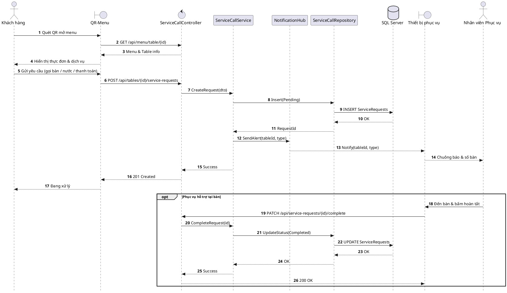

# Đặc tả UC-U2: Yêu cầu phục vụ thông qua QR menu

| Thuộc tính | Chi tiết |
| :--- | :--- |
| **Mã Use Case** | UC-U2 |
| **Tên Use Case** | Yêu cầu phục vụ thông qua QR menu |
| **Tác nhân** | Khách hàng (Chính), Nhân viên Phục vụ (Phụ) |
| **Mức độ ưu tiên** | Bắt buộc (Must Have) |
| **Mối quan hệ** | Độc lập; gửi thông báo tức thời tới thiết bị của nhân viên phục vụ |
| **Mục tiêu** | Khách quét mã QR tại bàn để xem thực đơn và gửi yêu cầu phục vụ (gọi nhân viên, thêm nước, đổi dụng cụ, yêu cầu thanh toán). |
| **Điều kiện tiên quyết** | Khách ngồi tại bàn đã check-in. |
| **Điều kiện kết thúc** | Yêu cầu được ghi nhận vào hệ thống, nhân viên nhận thông báo trên thiết bị và xác nhận hoàn tất tại bàn. |

## Luồng sự kiện chính (Main Flow)
1. Khách hàng quét mã QR tại bàn để mở QR-Menu.
2. Hệ thống hiển thị thực đơn và danh mục yêu cầu phục vụ của bàn.
3. Khách hàng chọn dịch vụ (gọi phục vụ, châm nước, đổi dụng cụ, yêu cầu thanh toán) và bấm gửi.
4. Hệ thống ghi nhận yêu cầu ở trạng thái Chờ xử lý (Pending).
5. Hệ thống gửi cảnh báo thời gian thực đến thiết bị của nhân viên phục vụ phụ trách bàn.
6. Hệ thống phản hồi xác nhận đang xử lý trên màn hình khách.
7. Nhân viên phục vụ đến bàn hỗ trợ và bấm hoàn tất trên thiết bị.

## Luồng ngoại lệ (Alternative / Exception Flows)
* 1a. Bàn chưa check-in hoặc ngoài ca: Hệ thống báo bàn chưa sẵn sàng.
* 3a. Gửi lặp lại dưới 60 giây: Hệ thống cảnh báo yêu cầu đang xử lý để tránh trùng.
* 5a. Mất kết nối mạng: Hệ thống tạm lưu yêu cầu và tự động đồng bộ lại ngay khi có kết nối.

## Sơ đồ tuần tự (Sequence Diagram)

