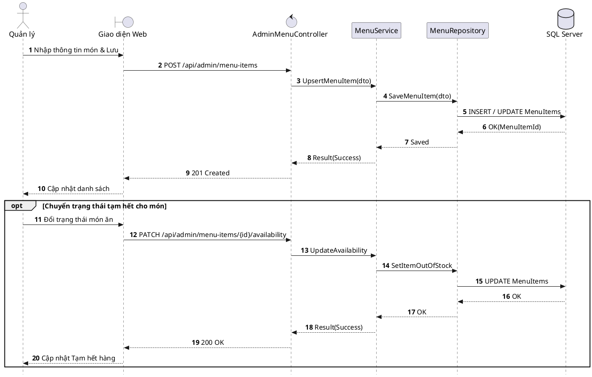

# Đặc tả UC-A1: Quản trị Danh mục, Thực đơn & Cấu hình Prep SLA món ăn

| Thuộc tính | Chi tiết đặc tả |
| :--- | :--- |
| **Mã Use Case** | UC-A1 |
| **Tên Use Case** | Quản trị Danh mục, Thực đơn & Cấu hình Prep SLA món ăn *(Menu Engineering, Pricing & Prep SLA Configuration)* |
| **Tác nhân tham gia** | Quản lý Nhà hàng *(Chính)*, Quản trị viên *(Phụ)* |
| **Mức độ ưu tiên** | Quan trọng *(Should Have)* |
| **Mối quan hệ** | Bao gồm Use Case cơ sở Đăng nhập UC-E5 |
| **Mục tiêu chức năng** | Cung cấp công cụ cho Quản lý thiết lập thực đơn, đơn giá, phân nhóm Course mặc định, cấu hình thời gian chế biến tiêu chuẩn (Prep SLA) và cập nhật trạng thái Còn món hoặc Hết món theo thời gian thực. |
| **Điều kiện tiên quyết** | Quản lý đã đăng nhập thành công vào hệ thống với quyền hạn phù hợp. |
| **Điều kiện kết thúc** | Thông tin thực đơn và cấu hình SLA được lưu trữ đồng bộ trong cơ sở dữ liệu, hiển thị tức thời trên E-Menu, TableDisplay, POS và màn hình KDS Bếp. |

## Luồng sự kiện chính (Main Flow)
1. Quản lý truy cập mục Quản lý thực đơn trên cổng thông tin quản trị.
2. Hệ thống hiển thị danh sách món ăn phân loại theo nhóm thực đơn và trạm bếp phụ trách.
3. Quản lý chọn chức năng Thêm món mới hoặc chọn một món ăn hiện có để Chỉnh sửa.
4. Quản lý nhập hoặc cập nhật bộ thông số chuẩn cho món ăn, bao gồm: Tên món, Mô tả nghệ thuật, Đơn giá niêm yết, Hình ảnh độ phân giải cao, Nhóm Course mặc định (Khai vị / Món chính / Tráng miệng), Trạm bếp chế biến (Bếp Lạnh / Bếp Nóng / Bếp Bánh) và Thời gian chuẩn bị định mức Prep SLA (tính bằng phút).
5. Quản lý bấm nút Lưu thay đổi.
6. Hệ thống kiểm tra tính hợp lệ của dữ liệu, lưu vào cơ sở dữ liệu và phát tín hiệu qua SignalR để đồng bộ tức thời xuống E-Menu, màn hình TableDisplay, thiết bị POS và bộ đếm SLA trên KDS Bếp.

## Luồng ngoại lệ (Alternative / Exception Flows)
* 6a. Khi bếp báo hết nguyên liệu đột xuất trong ca phục vụ, Quản lý (hoặc Nhân viên Điều phối) gạt nhanh công tắc chuyển trạng thái món sang Tạm hết hàng *(Out of Stock)*; hệ thống lập tức làm mờ món ăn trên E-Menu và chặn thao tác chọn món đó trên ứng dụng POS của nhân viên phục vụ.

## Sơ đồ tuần tự (Sequence Diagram)

