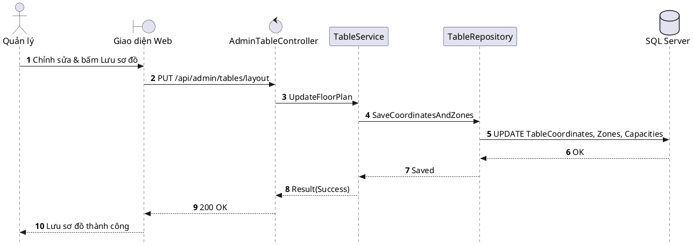

# Đặc tả UC-A2: Quản trị & Cấu hình Sơ đồ bàn ăn

| Thuộc tính | Chi tiết đặc tả |
| :--- | :--- |
| **Mã Use Case** | UC-A2 |
| **Tên Use Case** | Quản trị & Cấu hình Sơ đồ bàn ăn *(Floor Plan Layout & Table Mapping Configuration)* |
| **Tác nhân tham gia** | Quản lý Nhà hàng *(Chính)*, Quản trị viên *(Phụ)* |
| **Mức độ ưu tiên** | Quan trọng *(Should Have)* |
| **Mối quan hệ** | Bao gồm Use Case cơ sở Đăng nhập UC-E5 |
| **Mục tiêu chức năng** | Quản lý thiết lập bố cục không gian bàn ăn trực quan theo từng phân khu trên nền Canvas 2D, điều chỉnh vị trí, sức chứa và liên kết thiết bị hiển thị. |
| **Điều kiện tiên quyết** | Quản lý đã đăng nhập thành công với quyền hạn quản lý cấu hình mặt bằng. |
| **Điều kiện kết thúc** | Bố cục sơ đồ mặt bằng bàn ăn được lưu trữ an toàn và đồng bộ hóa tức thời qua SignalR tới ứng dụng di động của toàn bộ nhân viên. |

## Luồng sự kiện chính (Main Flow)
1. Quản lý mở giao diện Quản lý sơ đồ bàn trên trang quản trị.
2. Hệ thống hiển thị mặt bằng thiết kế dạng 2D Canvas trực quan.
3. Quản lý chọn phân khu bàn ăn (hoặc tạo phân khu mới), kéo thả vị trí bàn, chỉnh sửa tên bàn, sức chứa và hướng xoay không gian.
4. Quản lý gán mã thiết bị Digital Display hoặc Tablet tương ứng cho vị trí bàn.
5. Quản lý nhấn nút Lưu cấu hình.
6. Hệ thống kiểm tra dữ liệu, lưu vào cơ sở dữ liệu và đồng bộ sơ đồ mới tới toàn bộ thiết bị POS của nhân viên qua SignalR.

## Luồng ngoại lệ (Alternative / Exception Flows)
* 3a. Khi số lượng ghế vượt quá quy chuẩn diện tích khu vực hoặc trùng lặp mã bàn, hệ thống hiển thị cảnh báo lỗi và yêu cầu điều chỉnh lại thông số.

## Sơ đồ tuần tự (Sequence Diagram)

