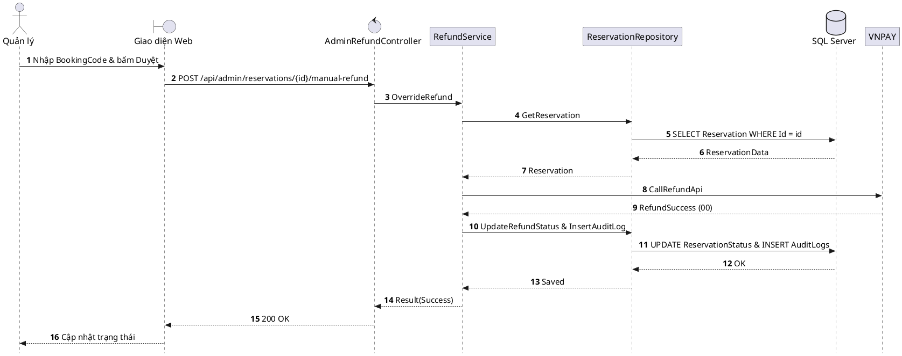

# Đặc tả UC-A3: Duyệt hoàn tiền cọc thủ công ngoại lệ

| Thuộc tính | Chi tiết đặc tả |
| :--- | :--- |
| **Mã Use Case** | UC-A3 |
| **Tên Use Case** | Duyệt hoàn tiền cọc thủ công ngoại lệ *(Manual Override Deposit Refund Approval)* |
| **Tác nhân tham gia** | Quản lý Nhà hàng *(Chính)*, Cổng thanh toán VNPAY *(Phụ)*, Hệ thống tự động *(Phụ)* |
| **Mức độ ưu tiên** | Quan trọng *(Should Have)* |
| **Mối quan hệ** | Bao gồm Use Case cơ sở Đăng nhập UC-E5; Tương tác cổng thanh toán VNPAY |
| **Mục tiêu chức năng** | Cho phép Quản lý xử lý hoàn lại tiền cọc cho khách hàng trong các tình huống phát sinh ngoại lệ hoặc sự cố bất khả kháng ngoài quy định tự động. |
| **Điều kiện tiên quyết** | Lịch đặt bàn đang ở trạng thái Đã hủy nhưng bị phạt cọc do hủy cận giờ (< 4 tiếng), hoặc khách hàng gửi khiếu nại chính đáng có căn cứ xác thực. |
| **Điều kiện kết thúc** | Khoản tiền cọc được hoàn trả về tài khoản khách hàng thông qua cổng VNPAY; hệ thống lưu vết nhật ký kiểm toán *(Audit Log)* ghi nhận danh tính người phê duyệt. |

## Luồng sự kiện chính (Main Flow)
1. Quản lý tra cứu mã đặt bàn BookingCode cần xử lý trên cổng thông tin quản trị.
2. Hệ thống hiển thị chi tiết lịch sử giao dịch cọc, mốc thời gian hủy và lý do chưa hoàn tiền tự động.
3. Quản lý chọn chức năng Hoàn cọc ngoại lệ *(Override Refund)*.
4. Quản lý nhập lý do giải trình phê duyệt (sự cố bất khả kháng, lỗi hệ thống) và bấm xác nhận.
5. Hệ thống gọi API sang cổng VNPAY để kích hoạt lệnh hoàn tiền cho khách hàng.
6. Hệ thống cập nhật trạng thái đặt cọc sang Đã hoàn ngoại lệ và ghi nhật ký kiểm toán *(Audit Log)* lưu vết người duyệt và thời gian thao tác.

## Luồng ngoại lệ (Alternative / Exception Flows)
* 5a. Khi kết nối API VNPAY bị gián đoạn, hệ thống lưu trạng thái giao dịch sang Chờ hoàn tiền, tự động thử lại theo chu kỳ và thông báo cho Quản lý theo dõi tiến độ.

## Sơ đồ tuần tự (Sequence Diagram)

