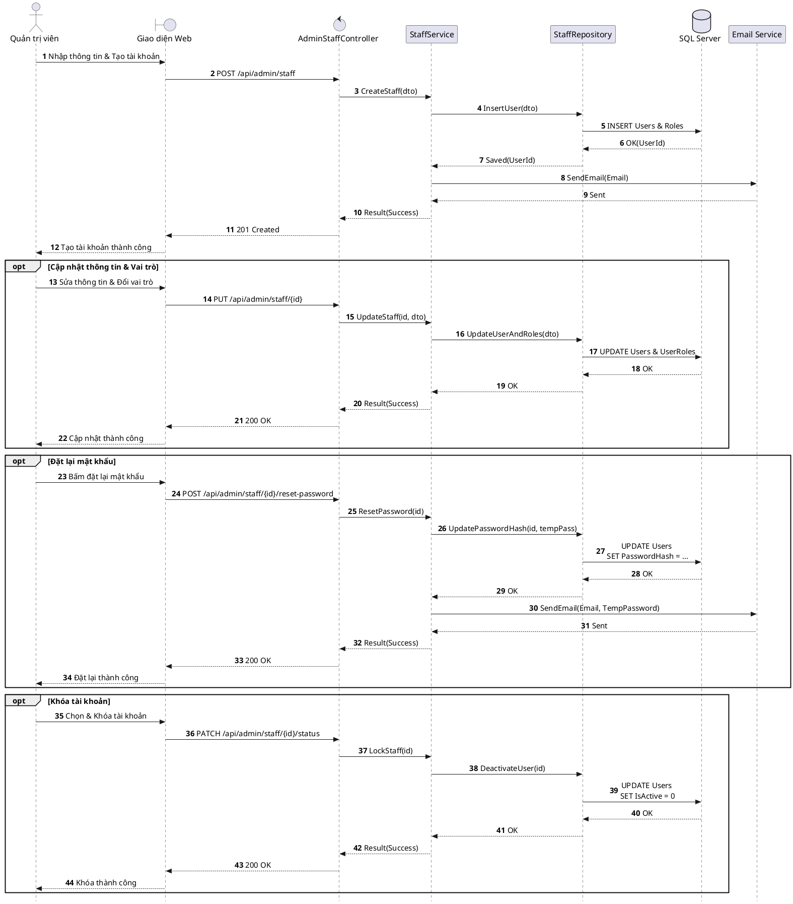

# Đặc tả UC-A4: Quản trị Tài khoản & Phân quyền nhân viên

| Thuộc tính | Chi tiết đặc tả |
| :--- | :--- |
| **Mã Use Case** | UC-A4 |
| **Tên Use Case** | Quản trị Tài khoản & Phân quyền nhân viên *(Staff Account & RBAC Role Provisioning)* |
| **Tác nhân tham gia** | Quản trị viên - System Admin *(Chính)* |
| **Mức độ ưu tiên** | Quan trọng *(Should Have)* |
| **Mối quan hệ** | Bao gồm Use Case cơ sở Đăng nhập UC-E5 |
| **Mục tiêu chức năng** | Quản trị viên quản lý danh sách nhân sự, khởi tạo tài khoản, phân bổ vai trò nghiệp vụ (Phục vụ, Điều phối, Quản lý) và khóa tài khoản khi nhân viên nghỉ việc. |
| **Điều kiện tiên quyết** | Quản trị viên đăng nhập với quyền hạn cao nhất trong hệ thống *(System Admin)*. |
| **Điều kiện kết thúc** | Thông tin nhân sự và quyền hạn truy cập được cập nhật chính xác và có hiệu lực ngay lập tức. |

## Luồng sự kiện chính (Main Flow)
1. Quản trị viên truy cập mục Quản lý nhân sự trên cổng thông tin quản trị.
2. Hệ thống hiển thị danh sách toàn bộ cán bộ nhân viên cùng vai trò quyền hạn tương ứng.
3. Quản trị viên chọn tính năng Tạo tài khoản mới hoặc chọn tài khoản cần chỉnh sửa.
4. Quản trị viên nhập Họ tên, Số điện thoại, Email và gán vai trò: Nhân viên Phục vụ, Nhân viên Điều phối, Quản lý Nhà hàng hoặc Quản trị viên.
5. Quản trị viên nhấn Lưu tài khoản.
6. Hệ thống lưu dữ liệu vào cơ sở dữ liệu ASP.NET Core Identity và tự động gửi email kích hoạt kèm mật khẩu tạm thời cho nhân viên.

## Luồng ngoại lệ (Alternative / Exception Flows)
* 3a. Khi nhân viên nghỉ việc hoặc có yêu cầu đình chỉ, Quản trị viên chọn Khóa tài khoản; hệ thống lập tức thu hồi toàn bộ quyền truy cập và hủy toàn bộ phiên làm việc của tài khoản trên mọi thiết bị.
* 3b. Khi nhân viên quên mật khẩu hoặc cần cấp lại, Quản trị viên bấm Đặt lại mật khẩu; hệ thống sinh mật khẩu ngẫu nhiên tạm thời, cập nhật mã băm bảo mật và tự động gửi qua email nhân sự.

## Sơ đồ tuần tự (Sequence Diagram)

