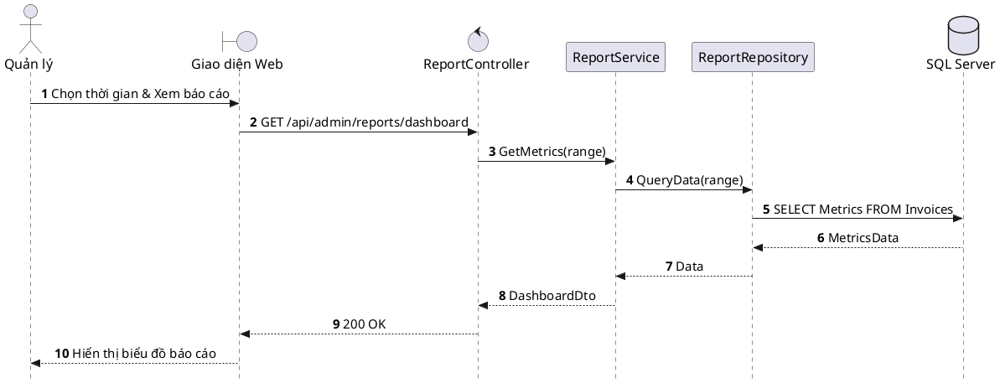

# Đặc tả UC-A5: Xem Báo cáo Thống kê & Dashboard doanh thu

| Thuộc tính | Chi tiết đặc tả |
| :--- | :--- |
| **Mã Use Case** | UC-A5 |
| **Tên Use Case** | Xem Báo cáo Thống kê & Dashboard doanh thu *(Analytics Dashboard & Revenue Reporting)* |
| **Tác nhân tham gia** | Quản lý Nhà hàng, Quản trị viên *(Chính)* |
| **Mức độ ưu tiên** | Bổ sung *(Could Have)* |
| **Mối quan hệ** | Bao gồm Use Case cơ sở Đăng nhập UC-E5 |
| **Mục tiêu chức năng** | Cung cấp bảng điều khiển trực quan tổng hợp doanh thu, tỷ lệ lấp đầy bàn ăn, số lượng hủy cọc và xếp hạng các món ăn bán chạy nhất theo thời gian thực. |
| **Điều kiện tiên quyết** | Quản lý hoặc Quản trị viên đã đăng nhập thành công vào cổng thông tin quản trị. |
| **Điều kiện kết thúc** | Các biểu đồ phân tích và bảng số liệu thống kê được hiển thị trực quan và hỗ trợ xuất báo cáo định kỳ. |

## Luồng sự kiện chính (Main Flow)
1. Quản lý truy cập mục Báo cáo thống kê trên cổng thông tin quản trị.
2. Quản lý chọn khoảng thời gian cần xem (Ngày, Tuần, Tháng hoặc Khoảng ngày tùy chỉnh).
3. Hệ thống tổng hợp dữ liệu từ các phân hệ Hóa đơn, Đặt bàn và Đơn hàng đã hoàn thành.
4. Hệ thống hiển thị biểu đồ biến động doanh thu, cơ cấu món bán chạy, tỷ lệ sử dụng bàn và các chỉ số vận hành chính.
5. Quản lý có thể nhấn nút Xuất báo cáo để tải tệp dữ liệu chi tiết dưới định dạng Excel hoặc PDF.

## Luồng ngoại lệ (Alternative / Exception Flows)
* 3a. Khi khoảng thời gian chọn không có dữ liệu giao dịch phát sinh, hệ thống hiển thị thông báo không có dữ liệu phù hợp và giữ nguyên giao diện biểu đồ mặc định.

## Sơ đồ tuần tự (Sequence Diagram)

