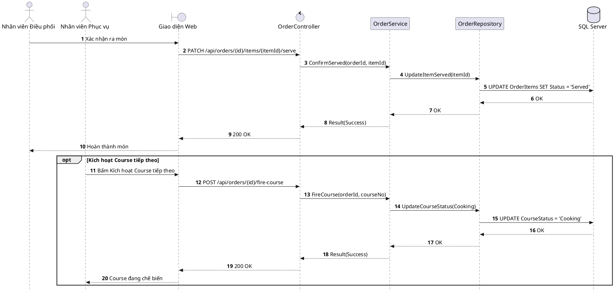

# Đặc tả UC-E2: Kiểm đồ tại quầy Pass, Phục vụ món & Kích hoạt Pacing Course kế tiếp

| Thuộc tính | Chi tiết đặc tả |
| :--- | :--- |
| **Mã Use Case** | UC-E2 |
| **Tên Use Case** | Kiểm đồ tại quầy Pass, Phục vụ món & Kích hoạt Pacing Course kế tiếp *(Expediter Pass Verification, Serving & Pacing Next Course)* |
| **Tác nhân tham gia** | Nhân viên Điều phối / Checkfood *(Chính)*, Nhân viên Phục vụ *(Phụ)*, Hệ thống tự động *(Phụ)* |
| **Mức độ ưu tiên** | Trọng yếu *(Must Have)* |
| **Mối quan hệ** | Bao gồm Use Case cơ sở Đăng nhập UC-E5; Tương tác với màn hình điều phối quầy Pass và KDS Bếp |
| **Mục tiêu chức năng** | Nhân viên Điều phối tại quầy Pass kiểm tra chất lượng và hình thức món ăn, bấm xác nhận hoàn thành để gọi phục vụ mang ra bàn; Nhân viên Phục vụ theo dõi tiến độ dùng bữa của khách để chủ động bấm lệnh Course Firing kích hoạt nấu Course kế tiếp. |
| **Điều kiện tiên quyết** | Các món ăn trong cùng một Course của bàn đã được nhà bếp hoàn tất chế biến và đặt tại quầy Pass. |
| **Điều kiện kết thúc** | Trạng thái món hiện tại chuyển sang Đã phục vụ *(Served)*; thông báo gửi tới thiết bị của nhân viên phục vụ; Course kế tiếp được chuyển sang Đang nấu *(Cooking)* khi nhân viên bấm Course Firing. |

## Luồng sự kiện chính (Main Flow)
1. Đầu bếp hoàn tất chế biến các đĩa ăn của Course hiện tại và đặt lên quầy Pass dưới đèn giữ nhiệt.
2. Nhân viên Điều phối (Expediter) đối chiếu hình thức trình bày và thành phần đĩa món thực tế với thông tin trên màn hình điều phối tại quầy Pass.
3. Nhân viên Điều phối bấm nút Xác nhận hoàn thành *(Served)* cho đợt món trên giao diện màn hình cảm ứng quầy Pass.
4. Hệ thống chuyển trạng thái các món trong Course hiện tại sang Đã phục vụ *(Served)*, ghi nhận thời gian hoàn thành thực tế so với định mức Prep SLA, gửi thông báo tức thời qua SignalR tới thiết bị cầm tay của nhân viên phục vụ và cập nhật trạng thái món sắp ra lên màn hình TableDisplay tại bàn.
5. Nhân viên phục vụ tiếp nhận đĩa ăn từ quầy Pass và mang món ăn ra phục vụ chính xác tại bàn cho khách.
6. Khi khách dùng được khoảng 60%–70% Course hiện tại, nhân viên phục vụ bấm nút Course Firing trên thiết bị cầm tay; hệ thống gửi sự kiện qua SignalR mở sáng các món thuộc Course kế tiếp từ trạng thái Chờ *(On Hold)* sang Đang nấu *(Cooking)* trên KDS Bếp và bắt đầu đếm ngược Prep SLA.

## Luồng ngoại lệ (Alternative / Exception Flows)
* 2a. Khi món ăn trình bày sai quy cách, sai nhiệt độ hoặc sai ghi chú yêu cầu, Nhân viên Điều phối bấm nút Từ chối *(Reject)* tại quầy Pass; hệ thống đẩy lại thẻ món với nhãn Ưu tiên khẩn cấp *(Remake Priority)* lên đầu màn hình KDS Bếp để bếp chế biến lại ngay lập tức.
* 6a. Khi bàn ăn có nguy cơ trễ giờ ca đặt kế tiếp hoặc khách có nhu cầu lên món gấp, nhân viên phục vụ bật nút gạt Ưu tiên *(Priority)* khi bấm Course Firing để đẩy vé món lên vị trí đầu tiên trên KDS Bếp.

## Sơ đồ tuần tự (Sequence Diagram)

