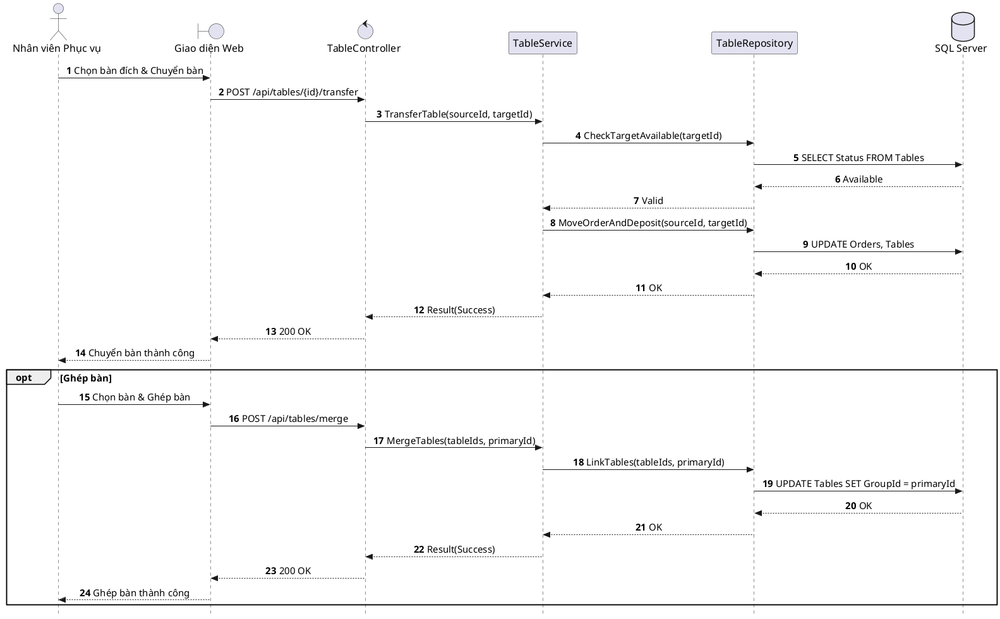

# Đặc tả UC-E4: Đổi bàn / Chuyển bàn phục vụ

| Thuộc tính | Chi tiết đặc tả |
| :--- | :--- |
| **Mã Use Case** | UC-E4 |
| **Tên Use Case** | Đổi bàn / Chuyển bàn phục vụ *(Table Transfer & Table Merge)* |
| **Tác nhân tham gia** | Nhân viên Phục vụ *(Chính)*, Quản lý Nhà hàng *(Phụ)* |
| **Mức độ ưu tiên** | Quan trọng *(Should Have)* |
| **Mối quan hệ** | Bao gồm Use Case cơ sở Đăng nhập UC-E5 |
| **Mục tiêu chức năng** | Cho phép nhân viên phục vụ hoặc quản lý chuyển toàn bộ đơn hàng hiện hành sang bàn trống khác khi khách hàng có nhu cầu đổi chỗ hoặc cần giải phóng bàn quá giờ cho ca đặt tiếp theo. |
| **Điều kiện tiên quyết** | Bàn ăn ban đầu đang ở trạng thái Đang phục vụ *(Occupied)*; vị trí bàn mới mong muốn chuyển đến phải ở trạng thái Sẵn sàng *(Available)*. |
| **Điều kiện kết thúc** | Toàn bộ dữ liệu đơn hàng được di chuyển sang bàn mới; bàn ăn cũ chuyển trạng thái sang Chờ dọn dẹp *(Cleaning)*; bàn ăn mới chuyển sang Đang phục vụ *(Occupied)*. |

## Luồng sự kiện chính (Main Flow)
1. Khách hàng yêu cầu đổi vị trí bàn hoặc Quản lý sảnh yêu cầu điều phối chuyển bàn để kịp đón lượt khách đặt ca sau.
2. Nhân viên phục vụ chọn chức năng Đổi bàn tại giao diện bàn hiện tại trên ứng dụng POS.
3. Hệ thống hiển thị sơ đồ các bàn đang ở trạng thái Sẵn sàng *(Available)* trong cùng ca phục vụ.
4. Nhân viên chọn vị trí bàn mới mong muốn và bấm Xác nhận chuyển bàn.
5. Hệ thống tự động di chuyển toàn bộ dữ liệu đơn hàng, danh mục món ăn và khoản tiền cọc sang mã bàn mới.
6. Hệ thống chuyển trạng thái bàn cũ sang Chờ dọn dẹp *(Cleaning)*, bàn mới sang Đang phục vụ *(Occupied)* và gửi thông báo cập nhật sơ đồ bàn thời gian thực tới quầy Pass và POS.

## Luồng ngoại lệ (Alternative / Exception Flows)
* 4a. Khi khách đi nhóm đông muốn gộp bàn, nhân viên sử dụng chức năng Ghép bàn để liên kết các bàn vật lý thành một nhóm và hợp nhất hóa đơn thanh toán chung.
* 4b. Khi bàn đích vừa được nhân viên khác chọn cùng thời điểm, hệ thống cảnh báo xung đột trạng thái bàn không còn trống và yêu cầu nhân viên chọn vị trí khác.

## Sơ đồ tuần tự (Sequence Diagram)

