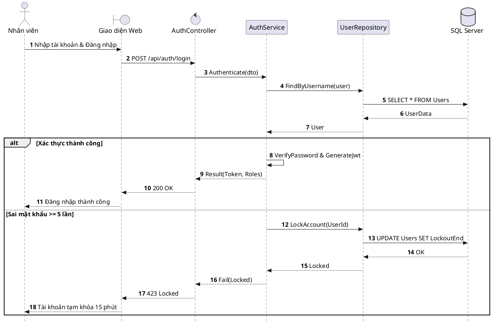

# Đặc tả UC-E5: Đăng nhập & Xác thực hệ thống nội bộ

| Thuộc tính | Chi tiết đặc tả |
| :--- | :--- |
| **Mã Use Case** | UC-E5 |
| **Tên Use Case** | Đăng nhập & Xác thực hệ thống nội bộ *(Staff Authentication & RBAC Authorization)* |
| **Tác nhân tham gia** | Nhân viên Phục vụ, Nhân viên Điều phối, Quản lý Nhà hàng, Quản trị viên *(Chính)* |
| **Mức độ ưu tiên** | Trọng yếu *(Must Have)* |
| **Mối quan hệ** | Use Case nền tảng *(Base Use Case)* cho toàn bộ các chức năng nội bộ |
| **Mục tiêu chức năng** | Cung cấp cơ chế xác thực danh tính an toàn và phân quyền truy cập dựa trên vai trò chức danh cho toàn bộ cán bộ nhân viên nhà hàng. |
| **Điều kiện tiên quyết** | Tài khoản nhân sự đã được Quản trị viên khởi tạo, phân bổ vai trò và kích hoạt trên hệ thống. |
| **Điều kiện kết thúc** | Người dùng được cấp mã thông báo JWT Bearer Token hợp lệ và được điều hướng tới giao diện màn hình làm việc tương ứng với quyền hạn. |

## Luồng sự kiện chính (Main Flow)
1. Nhân viên truy cập trang Đăng nhập trên trình duyệt máy tính hoặc thiết bị di động cầm tay.
2. Nhân viên nhập Tên đăng nhập (hoặc Email) và Mật khẩu bảo mật.
3. Nhân viên nhấn nút Đăng nhập.
4. Hệ thống xác thực danh tính tài khoản qua ASP.NET Core Identity và kiểm tra trạng thái kích hoạt của tài khoản.
5. Hệ thống cấp mã định danh JWT Bearer Token theo vai trò quyền hạn *(Roles)* và chuyển hướng người dùng tới màn hình làm việc tương ứng (POS Phục vụ, Quầy Pass, Trang quản trị).

## Luồng ngoại lệ (Alternative / Exception Flows)
* 4a. Khi thông tin đăng nhập không chính xác, hệ thống hiển thị cảnh báo lỗi và yêu cầu nhập lại.
* 4b. Khi nhập sai mật khẩu quá 5 lần liên tiếp, hệ thống tạm khóa tài khoản trong 15 phút để bảo vệ an toàn hệ thống.
* 5a. Khi mã JWT Bearer Token hết hạn trong phiên làm việc, hệ thống tự động làm mới phiên thông qua Refresh Token hoặc điều hướng về trang đăng nhập nếu phiên hết hạn hoàn toàn.

## Sơ đồ tuần tự (Sequence Diagram)

