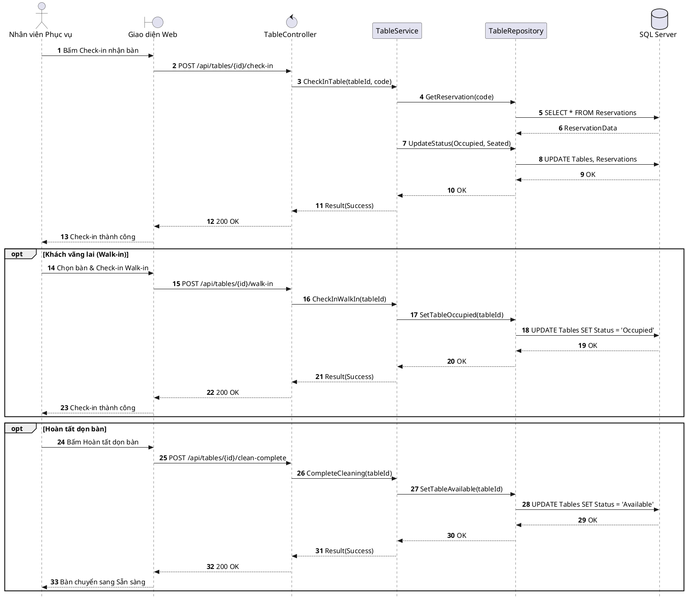

# Đặc tả UC-E6: Check-in nhận bàn & Hoàn tất dọn bàn

| Thuộc tính | Chi tiết đặc tả |
| :--- | :--- |
| **Mã Use Case** | UC-E6 |
| **Tên Use Case** | Check-in nhận bàn & Hoàn tất dọn bàn *(Table Check-in & Table Turn Cleaning)* |
| **Tác nhân tham gia** | Nhân viên Phục vụ *(Chính)*, Khách hàng *(Phụ)*, Hệ thống tự động *(Phụ)* |
| **Mức độ ưu tiên** | Trọng yếu *(Must Have)* |
| **Mối quan hệ** | Bao gồm Use Case cơ sở Đăng nhập UC-E5; Ngăn chặn tiến trình giải phóng bàn tự động UC-S1 |
| **Mục tiêu chức năng** | Cho phép nhân viên phục vụ xác nhận khách đặt cọc đã đến nhận bàn đúng giờ để chuyển trạng thái bàn sang Đang phục vụ (Occupied) tránh bị hệ thống quét hủy; đồng thời hỗ trợ đón khách vãng lai và xác nhận hoàn tất dọn bàn (Cleaning -> Available) sau khi thanh toán. |
| **Điều kiện tiên quyết** | Bàn ăn đang ở trạng thái Đã đặt chỗ *(Reserved)* kèm tiền cọc đã thanh toán hoặc ở trạng thái Chờ dọn dẹp *(Cleaning)*. |
| **Điều kiện kết thúc** | Bàn ăn chuyển sang trạng thái Đang phục vụ *(Occupied)* khi khách nhận bàn, hoặc chuyển về trạng thái Sẵn sàng *(Available)* khi hoàn tất dọn dẹp; sơ đồ bàn được đồng bộ tức thời qua SignalR. |

## Luồng sự kiện chính (Main Flow)
1. Khách hàng đến nhà hàng và đọc mã BookingCode hoặc Số điện thoại đặt bàn.
2. Nhân viên phục vụ tra cứu thông tin trên ứng dụng Web POS, chọn bàn đang ở trạng thái Đã đặt chỗ *(Reserved)* và đối chiếu thông tin đặt cọc.
3. Nhân viên phục vụ bấm nút Check-in nhận bàn trên giao diện POS.
4. Hệ thống kiểm tra hợp lệ, cập nhật trạng thái bàn sang Đang phục vụ *(Occupied)* và trạng thái đặt bàn sang Khách đã nhận bàn *(Seated)*.
5. Hệ thống gửi sự kiện SignalR tới toàn bộ thiết bị POS và màn hình quản lý sảnh để cập nhật màu sắc sơ đồ bàn (đánh dấu khách đã vào bàn an toàn, ngắt tiến trình tự động giải phóng bàn của UC-S1).
6. Nhân viên phục vụ dẫn khách vào vị trí bàn và kích hoạt phiên gọi món.

## Luồng ngoại lệ (Alternative / Exception Flows)
* 2a. Khi khách vãng lai (Walk-in) vào nhà hàng không đặt trước, nhân viên kiểm tra bàn đang ở trạng thái Sẵn sàng *(Available)*, chọn bàn và bấm Check-in khách vãng lai để chuyển bàn trực tiếp sang Đang phục vụ *(Occupied)*.
* 3a. Khi bàn ăn vừa được thanh toán xong ở trạng thái Chờ dọn dẹp *(Cleaning)* từ UC-E3, nhân viên phục vụ hoặc tạp vụ sau khi dọn dẹp, thay khăn và setup dao nĩa chuẩn Fine Dining sẽ bấm nút Hoàn tất dọn bàn trên POS; hệ thống chuyển trạng thái bàn từ Chờ dọn dẹp *(Cleaning)* về Sẵn sàng *(Available)* và phát SignalR cập nhật sơ đồ sàn để sẵn sàng đón lượt khách tiếp theo.

## Sơ đồ tuần tự (Sequence Diagram)

