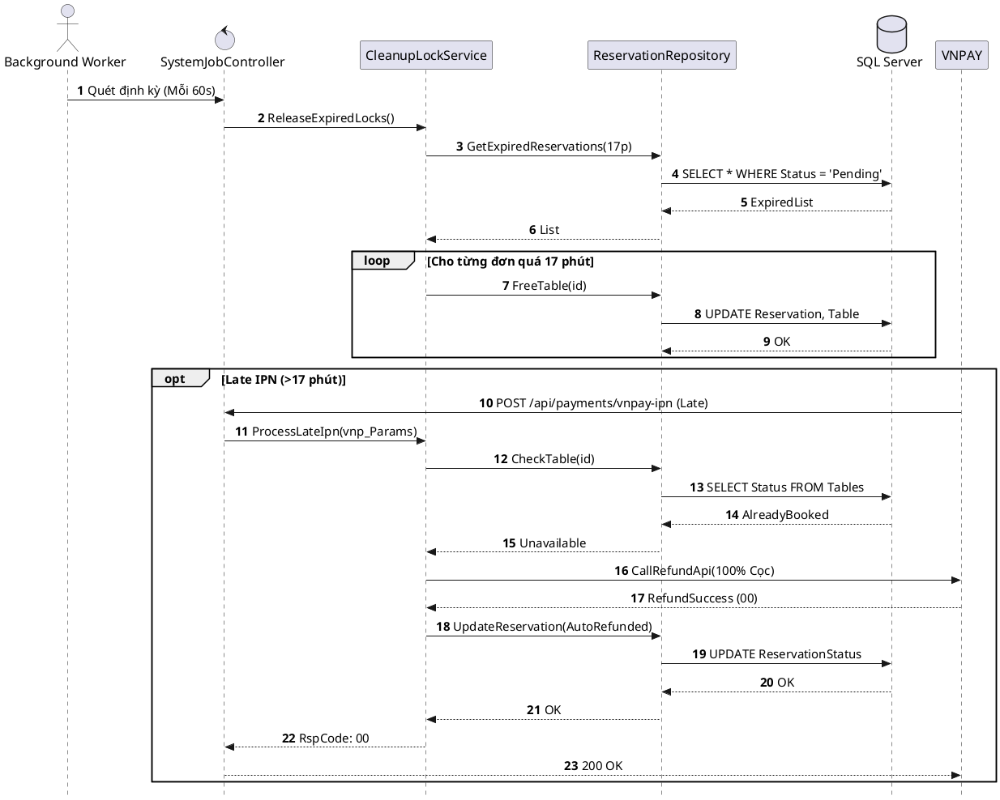

# Đặc tả UC-S1: Tự động giải phóng bàn hết hạn giữ cọc

| Thuộc tính | Chi tiết đặc tả |
| :--- | :--- |
| **Mã Use Case** | UC-S1 |
| **Tên Use Case** | Tự động giải phóng bàn hết hạn giữ cọc *(Auto-Release Expired Reservation Lock)* |
| **Tác nhân tham gia** | Hệ thống tự động / Background Worker *(Chính)* |
| **Mức độ ưu tiên** | Trọng yếu *(Must Have)* |
| **Mối quan hệ** | Mở rộng UC-U1 khi phát sinh quá hạn thời gian thanh toán |
| **Mục tiêu chức năng** | Tiến trình chạy ngầm định kỳ quét cơ sở dữ liệu mỗi 60 giây, tự động phát hiện và hủy các phiên đặt bàn quá 17 phút mà chưa nhận được thanh toán cọc, giải phóng bàn về trạng thái sẵn sàng và đồng bộ sơ đồ qua SignalR. |
| **Điều kiện tiên quyết** | Tồn tại các bản ghi đặt bàn ở trạng thái Chờ thanh toán *(Pending Payment)* có thời gian khởi tạo vượt quá 17 phút. |
| **Điều kiện kết thúc** | Vị trí bàn ăn được giải phóng về trạng thái Sẵn sàng *(Available)*; phiên đặt bàn chuyển sang Hết hạn *(Expired_Cancelled)*; sơ đồ bàn trên thiết bị của nhân viên được cập nhật màu sắc thời gian thực. |

## Luồng sự kiện chính (Main Flow)
1. Tiến trình Background Worker tự động chạy ngầm định kỳ mỗi 60 giây một lần.
2. Hệ thống quét cơ sở dữ liệu tìm các đơn đặt bàn ở trạng thái Chờ thanh toán *(Pending Payment)* có thời gian khóa vượt quá 17 phút.
3. Hệ thống chuyển trạng thái các đơn đặt bàn này sang Đã hủy do hết hạn *(Expired_Cancelled)*.
4. Hệ thống chuyển trạng thái vị trí bàn ăn từ Khóa giữ bàn *(Locked)* về Sẵn sàng *(Available)*.
5. Hệ thống gửi sự kiện qua SignalR để đồng bộ sơ đồ mặt bằng bàn ăn thời gian thực tới toàn bộ nhân viên và quản lý.
6. Hệ thống ghi nhật ký kiểm toán *(Audit Log)* lưu vết sự kiện giải phóng bàn tự động.

## Luồng ngoại lệ (Alternative / Exception Flows)
* 2a. Khi nhận được tín hiệu IPN thanh toán thành công trễ (>17 phút) từ VNPAY mà bàn cũ đã có khách hàng khác đặt thành công, hệ thống chuyển đơn sang trạng thái xử lý ngoại lệ và tự động hoàn trả 100% tiền cọc cho khách.

## Sơ đồ tuần tự (Sequence Diagram)

