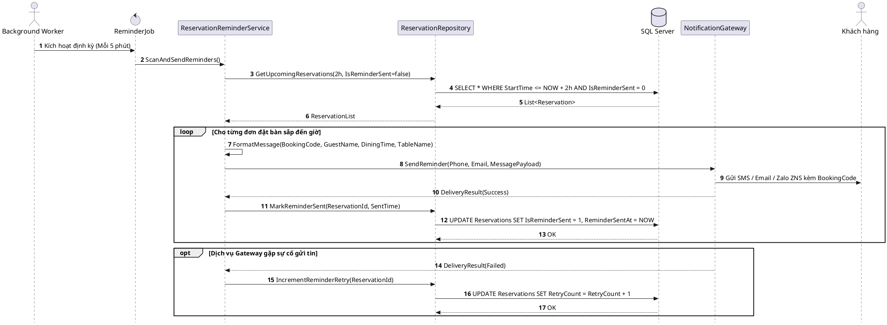

# Đặc tả UC-S2: Tự động gửi thông báo nhắc lịch hẹn

| Thuộc tính | Chi tiết đặc tả |
| :--- | :--- |
| **Mã Use Case** | UC-S2 |
| **Tên Use Case** | Tự động gửi thông báo nhắc lịch hẹn *(Scheduled Reservation Reminder Service)* |
| **Tác nhân tham gia** | Hệ thống tự động / Background Worker *(Chính)*, Khách hàng *(Guest)* *(Phụ)*, Cổng gửi tin SMS / Email Gateway *(Phụ)* |
| **Mức độ ưu tiên** | Quan trọng *(Should Have)* |
| **Mối quan hệ** | Kết hợp dữ liệu từ đặt bàn trực tuyến UC-U1 |
| **Mục tiêu chức năng** | Tiến trình chạy ngầm định kỳ quét các đơn đặt bàn trước giờ hẹn 2 tiếng, tự động phát lệnh gửi SMS/Email/Zalo ZNS nhắc khách nhớ giờ đến kèm mã đặt bàn và thông tin bữa tiệc. |
| **Điều kiện tiên quyết** | Đơn đặt bàn ở trạng thái Đã xác nhận *(Confirmed)* với tiền cọc hợp lệ, thời gian bắt đầu tiệc cách thời điểm hiện tại 2 tiếng và chưa gửi thông báo nhắc lịch. |
| **Điều kiện kết thúc** | Thông báo nhắc lịch được chuyển giao thành công tới cổng gửi tin; hệ thống đánh dấu đơn đã được gửi nhắc nhở và ghi nhận thời gian gửi vào cơ sở dữ liệu. |

## Luồng sự kiện chính (Main Flow)
1. Tiến trình Background Worker tự động kích hoạt định kỳ mỗi 5 phút một lần.
2. Hệ thống quét cơ sở dữ liệu tìm các đơn đặt bàn có trạng thái Đã xác nhận, có giờ ăn cách thời điểm hiện tại 2 tiếng và chưa gửi nhắc nhở.
3. Hệ thống tạo nội dung thông điệp gồm mã đặt bàn, tên khách hàng, thời gian dùng bữa, tên bàn và hướng dẫn chỉ đường.
4. Hệ thống gọi dịch vụ cổng gửi tin để phát thông báo qua SMS, Email hoặc Zalo ZNS tới thông tin liên lạc của khách hàng.
5. Cổng gửi tin phản hồi kết quả chuyển phát thành công.
6. Hệ thống cập nhật cờ đã gửi thông báo và thời điểm gửi vào bản ghi đặt bàn.
7. Hệ thống ghi nhật ký kiểm toán lưu vết phiên gửi thông báo tự động.

## Luồng ngoại lệ (Alternative / Exception Flows)
* 4a. Khi dịch vụ cổng gửi tin phản hồi lỗi hoặc quá thời gian chờ, hệ thống tăng số lần thử lại của đơn đặt bàn và xếp lịch tái gửi trong chu kỳ quét kế tiếp.

## Sơ đồ tuần tự (Sequence Diagram)

