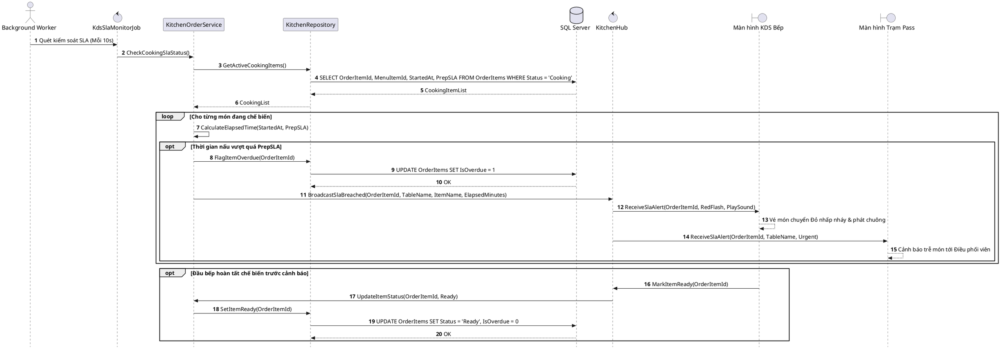

# Đặc tả UC-S3: Tự động kiểm soát & cảnh báo trễ SLA chế biến món ăn

| Thuộc tính | Chi tiết đặc tả |
| :--- | :--- |
| **Mã Use Case** | UC-S3 |
| **Tên Use Case** | Tự động kiểm soát & cảnh báo trễ SLA chế biến món ăn *(KDS Prep SLA Monitor)* |
| **Tác nhân tham gia** | Hệ thống tự động / Background Worker *(Chính)*, Nhân viên Điều phối *(Expediter)* *(Phụ)*, Đầu bếp Bếp KDS *(Phụ)* |
| **Mức độ ưu tiên** | Trọng yếu *(Must Have)* |
| **Mối quan hệ** | Hỗ trợ điều phối lượt món UC-E1 và kiểm đồ quầy Pass UC-E2 theo quy định thời gian chế biến |
| **Mục tiêu chức năng** | Tiến trình chạy ngầm liên tục đếm ngược thời gian nấu của từng món ăn; tự động kích hoạt cảnh báo đổi màu đỏ nhấp nháy và phát chuông âm thanh tới màn hình KDS Bếp và trạm Điều phối viên khi thời gian vượt định mức Prep SLA. |
| **Điều kiện tiên quyết** | Món ăn trong đơn gọi món đang ở trạng thái Chế biến *(Cooking)* trên hệ thống KDS. |
| **Điều kiện kết thúc** | Cờ quá hạn được thiết lập; thông điệp cảnh báo trễ hạn kèm tín hiệu âm thanh và thị giác được truyền phát tức thời qua SignalR tới màn hình Bếp và trạm Pass. |

## Luồng sự kiện chính (Main Flow)
1. Tiến trình Background Worker tự động quét kiểm soát định kỳ mỗi 10 giây một lần.
2. Hệ thống truy vấn danh sách toàn bộ các món ăn đang trong trạng thái Chế biến.
3. Hệ thống tính toán thời gian nấu thực tế đã trôi qua dựa trên mốc bắt đầu nấu và thời lượng định mức của món.
4. Khi thời gian chế biến vượt ngưỡng định mức, hệ thống cập nhật cờ quá hạn của món ăn trong cơ sở dữ liệu.
5. Hệ thống gửi sự kiện cảnh báo trễ hạn qua kênh thời gian thực SignalR tới màn hình KDS Bếp và máy trạm của Điều phối viên.
6. Màn hình KDS Bếp và trạm Điều phối hiển thị vé món chuyển màu đỏ nhấp nháy đồng thời kích hoạt chuông âm thanh cảnh báo ưu tiên.
7. Hệ thống ghi nhật ký kiểm toán lưu vết sự kiện trễ SLA món ăn phục vụ thống kê vận hành.

## Luồng ngoại lệ (Alternative / Exception Flows)
* 3a. Khi Đầu bếp nhấn xác nhận hoàn thành món ăn trước thời điểm quét cảnh báo, hệ thống chuyển món sang trạng thái Sẵn sàng và loại bỏ món khỏi danh sách đếm ngược quá hạn.

## Sơ đồ tuần tự (Sequence Diagram)

