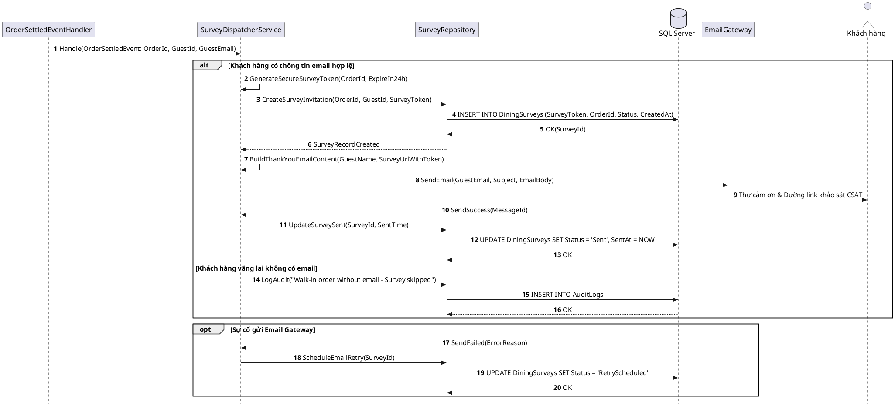

# Đặc tả UC-S4: Tự động gửi email cảm ơn & link khảo sát CSAT sau bữa ăn

| Thuộc tính | Chi tiết đặc tả |
| :--- | :--- |
| **Mã Use Case** | UC-S4 |
| **Tên Use Case** | Tự động gửi email cảm ơn & link khảo sát CSAT sau bữa ăn *(Post-Dining CSAT Survey & Thank-You Dispatcher)* |
| **Tác nhân tham gia** | Hệ thống tự động *(Chính)*, Khách hàng *(Guest)* *(Phụ)*, Dịch vụ Email Gateway *(Phụ)* |
| **Mức độ ưu tiên** | Bổ sung *(Could Have)* |
| **Mối quan hệ** | Tự động kích hoạt sau khi hoàn tất thanh toán hóa đơn UC-E3; tạo dữ liệu đầu vào cho gửi đánh giá dịch vụ UC-U4 |
| **Mục tiêu chức năng** | Tự động tạo mã khảo sát trực tuyến an toàn và gửi thư cảm ơn kèm liên kết đánh giá mức độ hài lòng (CSAT) tới hòm thư của khách hàng ngay sau khi đóng bàn. |
| **Điều kiện tiên quyết** | Bàn ăn đã hoàn tất thanh toán và đóng bàn thành công tại UC-E3, hồ sơ đặt bàn có địa chỉ email hợp lệ của khách hàng. |
| **Điều kiện kết thúc** | Bản ghi khảo sát được khởi tạo với mã token hợp lệ trong 24 giờ; thư điện tử cảm ơn kèm đường dẫn chấm điểm dịch vụ được gửi tới khách hàng. |

## Luồng sự kiện chính (Main Flow)
1. Hệ thống tiếp nhận sự kiện thanh toán và đóng bàn thành công từ nghiệp vụ thanh toán.
2. Hệ thống kiểm tra thông tin địa chỉ email của khách hàng liên kết với bàn ăn.
3. Hệ thống tạo mã bảo mật khảo sát gắn liền với bữa ăn có hiệu lực trong vòng 24 giờ.
4. Hệ thống khởi tạo bản ghi khảo sát trong cơ sở dữ liệu ở trạng thái Đang chờ gửi.
5. Hệ thống kết xuất nội dung thư cảm ơn trang trọng kèm liên kết truy cập trang khảo sát CSAT.
6. Hệ thống chuyển giao thư tới cổng dịch vụ gửi email để chuyển phát tới hòm thư của khách hàng.
7. Cổng gửi email phản hồi gửi thành công; hệ thống cập nhật trạng thái bản ghi khảo sát sang Đã gửi và ghi nhận thời điểm hoàn tất.

## Luồng ngoại lệ (Alternative / Exception Flows)
* 2a. Khi khách hàng dùng bữa là khách vãng lai và không để lại địa chỉ email, hệ thống bỏ qua bước phát thư khảo sát và kết thúc phiên đóng bàn bình thường.
* 6a. Khi dịch vụ gửi email gặp sự cố kết nối, hệ thống đánh dấu bản ghi khảo sát ở trạng thái Chờ gửi lại để hàng đợi tự động tái phát lệnh sau 5 phút.

## Sơ đồ tuần tự (Sequence Diagram)

