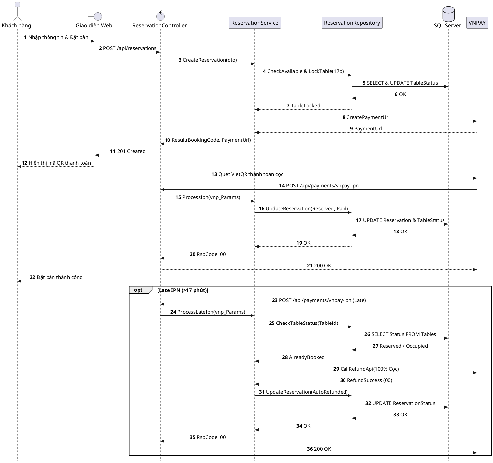

# Đặc tả UC-U1: Đặt bàn trực tuyến & Đặt cọc giữ chỗ

| Thuộc tính | Chi tiết đặc tả |
| :--- | :--- |
| **Mã Use Case** | UC-U1 |
| **Tên Use Case** | Đặt bàn trực tuyến & Đặt cọc giữ chỗ *(Online Reservation & Deposit Settlement)* |
| **Tác nhân tham gia** | Khách hàng *(Chính)*, Cổng thanh toán VNPAY *(Phụ)*, Hệ thống tự động *(Phụ)* |
| **Mức độ ưu tiên** | Trọng yếu *(Must Have)* |
| **Mối quan hệ** | Bao gồm tương tác cổng VNPAY để thanh toán; Mở rộng tác vụ nền giải phóng bàn UC-S1 khi quá hạn giữ chỗ 17 phút |
| **Mục tiêu chức năng** | Cho phép khách hàng truy cập website, tra cứu sơ đồ bàn theo thời gian thực, lựa chọn thời điểm và vị trí bàn mong muốn, sau đó thanh toán tiền cọc cố định qua VNPAY để xác nhận giữ chỗ chắc chắn. |
| **Điều kiện tiên quyết** | Khách hàng truy cập website đặt chỗ của nhà hàng; sơ đồ mặt bằng bàn ăn đang trong trạng thái hoạt động. |
| **Điều kiện kết thúc** | Vị trí bàn ăn chuyển sang trạng thái Đã đặt chỗ *(Reserved)*; hệ thống ghi nhận khoản cọc thành công và tự động tạo mã BookingCode gửi qua SMS/Email xác nhận. |

## Luồng sự kiện chính (Main Flow)
1. Khách hàng lựa chọn ngày dùng bữa, ca phục vụ (khung giờ chia theo mốc 15 phút kèm 15 phút đệm dọn bàn), số lượng khách và khu vực ngồi mong muốn (Sảnh chính, VIP, Ban công).
2. Hệ thống hiển thị các bàn còn trống theo thời gian thực tương ứng trên sơ đồ mặt bằng.
3. Khách hàng chọn vị trí bàn, nhập thông tin cá nhân (Họ tên, Số điện thoại, Email, ghi chú yêu cầu riêng nếu có) và nhấn nút xác nhận đặt cọc.
4. Hệ thống khóa giữ bàn tạm thời trong 17 phút (15 phút hiệu lực mã QR thanh toán VNPAY + 2 phút ân hạn bù độ trễ mạng) và chuyển hướng khách hàng sang cổng thanh toán VNPAY.
5. Khách hàng thực hiện quét mã VietQR hoặc nhập thông tin thẻ ngân hàng trong thời hạn 15 phút.
6. Cổng thanh toán VNPAY gửi tín hiệu IPN callback xác nhận thanh toán thành công về máy chủ hệ thống.
7. Hệ thống chuyển trạng thái bàn ăn sang Đã đặt chỗ *(Reserved)*, tạo mã đặt bàn BookingCode và gửi thông báo xác nhận kèm chi tiết lịch hẹn qua SMS/Email cho khách hàng.

## Luồng ngoại lệ (Alternative / Exception Flows)
* 2a. Khi hết bàn trống hoặc hết khung giờ, hệ thống hiển thị thông báo gợi ý khung giờ hoặc khu vực khác; khách hàng chọn lại hoặc dừng thao tác.
* 3a. Khi thiếu hoặc sai định dạng số điện thoại/email, hệ thống báo lỗi trực tiếp tại ô nhập liệu và tạm khóa thao tác tiếp tục.
* 5a. Khi giao dịch thanh toán bị hủy hoặc phát sinh lỗi mạng, hệ thống duy trì khóa giữ bàn nếu vẫn còn trong thời hạn 17 phút để khách hàng thao tác lại.
* 5b. Khi quá 17 phút chưa hoàn tất thanh toán, hệ thống tự động hủy phiên đặt bàn và giải phóng bàn về trạng thái Sẵn sàng *(Available)*.
* 6a. Khi nhận được tín hiệu thanh toán thành công trễ (>17 phút) mà bàn đó đã được khách hàng khác đặt trước, hệ thống chuyển giao dịch sang trạng thái ngoại lệ và hoàn trả 100% tiền cọc cho khách.
* 7a. Khi hệ thống gửi tin nhắn SMS/Email xác nhận thất bại, hệ thống đẩy yêu cầu vào hàng đợi gửi bù và hiển thị trực tiếp mã BookingCode trên màn hình trình duyệt.

## Sơ đồ tuần tự (Sequence Diagram)

