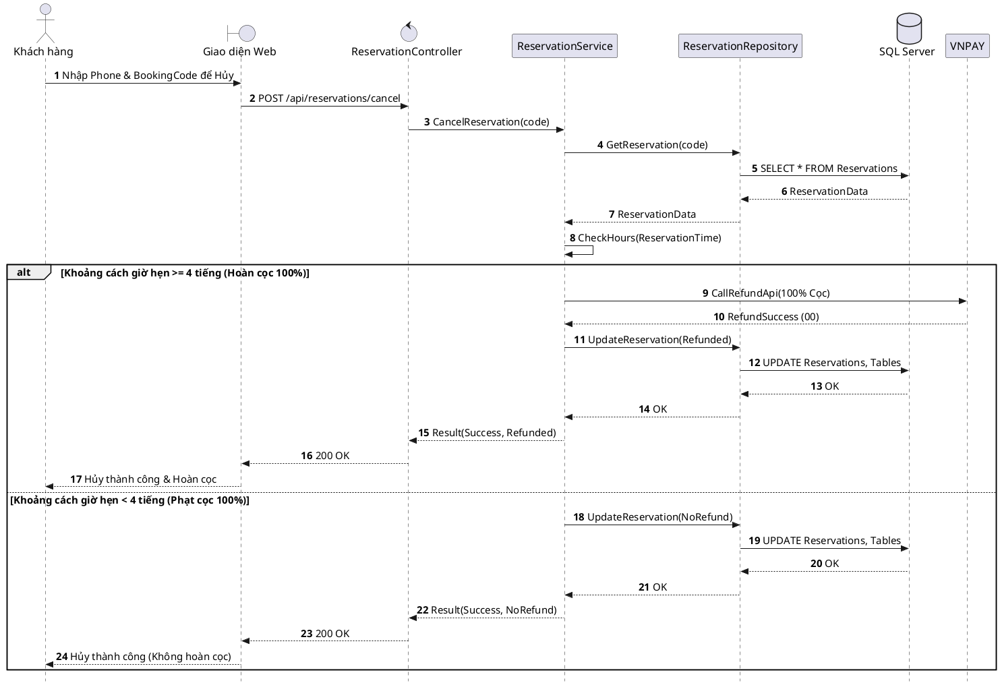

# Đặc tả UC-U3: Hủy đặt bàn trực tuyến & Hoàn cọc tự động

| Thuộc tính | Chi tiết đặc tả |
| :--- | :--- |
| **Mã Use Case** | UC-U3 |
| **Tên Use Case** | Hủy đặt bàn trực tuyến & Hoàn cọc tự động *(Online Reservation Cancellation & Auto-Refund)* |
| **Tác nhân tham gia** | Khách hàng *(Chính)*, Cổng thanh toán VNPAY *(Phụ)*, Hệ thống tự động *(Phụ)* |
| **Mức độ ưu tiên** | Trọng yếu *(Must Have)* |
| **Mối quan hệ** | Bao gồm tương tác cổng VNPAY để xử lý lệnh hoàn tiền cọc tự động qua API |
| **Mục tiêu chức năng** | Cho phép khách hàng chủ động hủy lịch đặt bàn trực tuyến trên hệ thống; hệ thống tự động kiểm tra mốc thời gian đối chiếu chính sách hoàn hủy để thực hiện hoàn cọc hoặc phạt cọc hoàn toàn tự động. |
| **Điều kiện tiên quyết** | Khách hàng sở hữu một mã đặt bàn BookingCode đang ở trạng thái hợp lệ Đã đặt chỗ *(Reserved)*. |
| **Điều kiện kết thúc** | Trạng thái lịch đặt bàn chuyển sang Đã hủy *(Cancelled)*; vị trí bàn ăn được giải phóng về trạng thái Sẵn sàng *(Available)*; giao dịch hoàn tiền hoặc giữ cọc được ghi nhận vào hệ thống. |

## Luồng sự kiện chính (Main Flow)
1. Khách hàng truy cập trang Tra cứu đặt bàn trên website, nhập Số điện thoại và mã BookingCode đã nhận.
2. Hệ thống kiểm tra thông tin và hiển thị chi tiết lịch hẹn kèm nút Hủy đặt bàn.
3. Khách hàng nhấn nút Hủy đặt bàn và xác nhận đồng ý với điều khoản chính sách hoàn hủy.
4. Hệ thống kiểm tra khoảng cách thời gian từ thời điểm yêu cầu hủy đến giờ hẹn dùng bữa thực tế.
5. Khi khoảng thời gian đến giờ hẹn còn từ 4 tiếng trở lên, hệ thống tự động gọi API sang cổng VNPAY để xử lý lệnh hoàn trả 100% tiền cọc cho khách hàng.
6. Hệ thống chuyển trạng thái đặt bàn sang Đã hủy *(Cancelled)* và đưa vị trí bàn ăn trở về trạng thái Sẵn sàng *(Available)*.
7. Hệ thống gửi thông báo xác nhận hủy bàn kèm chứng từ hoàn tiền qua SMS/Email cho khách hàng.

## Luồng ngoại lệ (Alternative / Exception Flows)
* 1a. Khi nhập sai Số điện thoại hoặc mã BookingCode, hệ thống hiển thị thông báo không tìm thấy lịch hẹn và yêu cầu khách hàng kiểm tra lại thông tin.
* 5a. Khi khoảng thời gian đến giờ hẹn dưới 4 tiếng, hệ thống hiển thị cảnh báo phạt mất 100% tiền cọc; sau khi khách hàng xác nhận tiếp tục, hệ thống hủy lịch hẹn, giữ lại khoản tiền cọc và giải phóng bàn về trạng thái Sẵn sàng *(Available)*.

## Sơ đồ tuần tự (Sequence Diagram)

