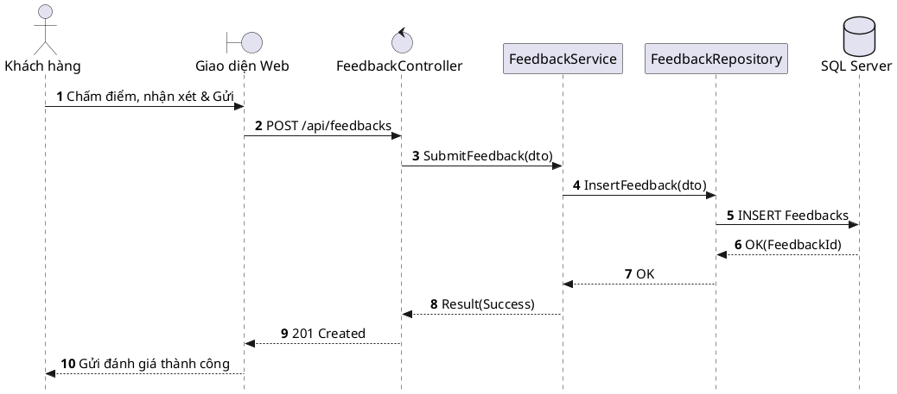

# Đặc tả UC-U4: Gửi đánh giá và phản hồi chất lượng dịch vụ

| Thuộc tính | Chi tiết đặc tả |
| :--- | :--- |
| **Mã Use Case** | UC-U4 |
| **Tên Use Case** | Gửi đánh giá và phản hồi chất lượng dịch vụ *(Guest Post-Dining Review & CSAT)* |
| **Tác nhân tham gia** | Khách hàng *(Chính)*, Quản lý Nhà hàng *(Phụ)* |
| **Mức độ ưu tiên** | Bổ sung *(Could Have)* |
| **Mối quan hệ** | Độc lập (Thu thập khảo sát mức độ hài lòng khách hàng sau trải nghiệm ẩm thực) |
| **Mục tiêu chức năng** | Thu thập ý kiến đánh giá định lượng và đóng góp nhận xét chất lượng từ khách hàng sau bữa ăn nhằm cải tiến chất lượng dịch vụ nhà hàng. |
| **Điều kiện tiên quyết** | Khách hàng đã dùng bữa xong và hoàn tất thủ tục thanh toán hóa đơn. |
| **Điều kiện kết thúc** | Dữ liệu đánh giá và chấm điểm được lưu trữ an toàn vào cơ sở dữ liệu và hiển thị trên bảng thống kê CSAT của Quản lý. |

## Luồng sự kiện chính (Main Flow)
1. Khách hàng quét mã QR in trên hóa đơn thanh toán hoặc bấm vào liên kết khảo sát trong email cảm ơn sau bữa ăn.
2. Khách hàng thực hiện chấm điểm thang 1–5 sao cho các hạng mục: Chất lượng món ăn, Không gian nhà hàng và Thái độ phục vụ.
3. Khách hàng nhập ý kiến nhận xét chi tiết (nếu có) và nhấn nút Gửi đánh giá.
4. Hệ thống lưu kết quả đánh giá vào cơ sở dữ liệu và tự động cập nhật chỉ số đo lường sự hài lòng (CSAT) lên cổng quản trị của Quản lý.

## Luồng ngoại lệ (Alternative / Exception Flows)
* 1a. Khi khách hàng truy cập liên kết đánh giá đã hết hạn (quá 48 giờ kể từ thời điểm đóng bàn), hệ thống hiển thị thông báo phiên đánh giá đã kết thúc và gửi lời cảm ơn khách hàng.

## Sơ đồ tuần tự (Sequence Diagram)

