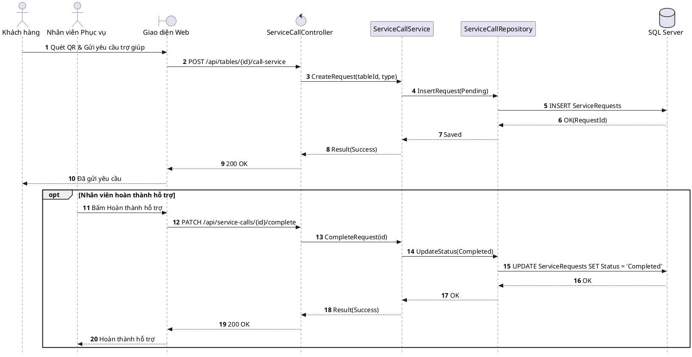

# Đặc tả UC-U5: Khách gọi trợ giúp qua QR tại bàn

| Thuộc tính | Chi tiết đặc tả |
| :--- | :--- |
| **Mã Use Case** | UC-U5 |
| **Tên Use Case** | Khách gọi trợ giúp qua QR tại bàn *(Guest In-Dining Service Call via Table QR)* |
| **Tác nhân tham gia** | Khách hàng *(Chính)*, Nhân viên Phục vụ *(Phụ)* |
| **Mức độ ưu tiên** | Quan trọng *(Should Have)* |
| **Mối quan hệ** | Độc lập hoặc kích hoạt từ E-Menu quét mã QR tại bàn |
| **Mục tiêu chức năng** | Cho phép khách hàng đang ngồi dùng bữa quét mã QR tại bàn để gửi yêu cầu hỗ trợ nhanh (gọi phục vụ, châm thêm nước/rượu, thay dao nĩa/đĩa mới, yêu cầu tính tiền) đến nhân viên phụ trách khu vực. |
| **Điều kiện tiên quyết** | Khách hàng đã ngồi tại bàn ăn thực tế có gắn mã QR định danh bàn. |
| **Điều kiện kết thúc** | Yêu cầu trợ giúp được ghi nhận vào CSDL ở trạng thái Chờ xử lý *(Pending)*; nhân viên phục vụ tiếp nhận thông tin và đến hỗ trợ tại bàn. |

## Luồng sự kiện chính (Main Flow)
1. Khách hàng quét mã QR gắn tại bàn bằng điện thoại cá nhân để mở giao diện yêu cầu trợ giúp trên trình duyệt web.
2. Khách hàng lựa chọn loại hỗ trợ cần thiết (Gọi nhân viên, Châm nước/rượu, Thay dao nĩa mới, Yêu cầu thanh toán) hoặc nhập ghi chú nhanh.
3. Khách hàng nhấn nút Gửi yêu cầu trợ giúp.
4. Hệ thống lưu yêu cầu vào cơ sở dữ liệu ở trạng thái Chờ xử lý *(Pending)*.
5. Hệ thống hiển thị thông báo gửi thành công trên điện thoại của khách hàng.
6. Nhân viên phục vụ tra cứu danh sách yêu cầu trên thiết bị POS, đến bàn xử lý trực tiếp cho khách và bấm xác nhận hoàn thành hỗ trợ.

## Luồng ngoại lệ (Alternative / Exception Flows)
* 1a. Khi khách quét mã QR của bàn chưa kích hoạt hoặc ngoài giờ phục vụ, hệ thống hiển thị thông báo bàn chưa sẵn sàng và hướng dẫn liên hệ trực tiếp nhân viên sảnh.
* 3a. Khi cùng một bàn gửi lặp lại yêu cầu trong vòng 60 giây, hệ thống hiển thị thông báo yêu cầu trước đó đang được xử lý để tránh spam.

## Sơ đồ tuần tự (Sequence Diagram)

